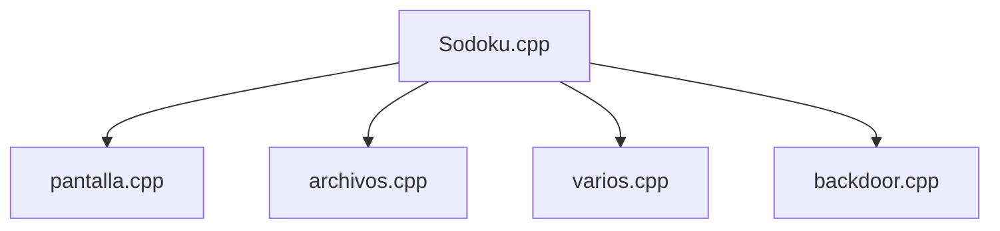
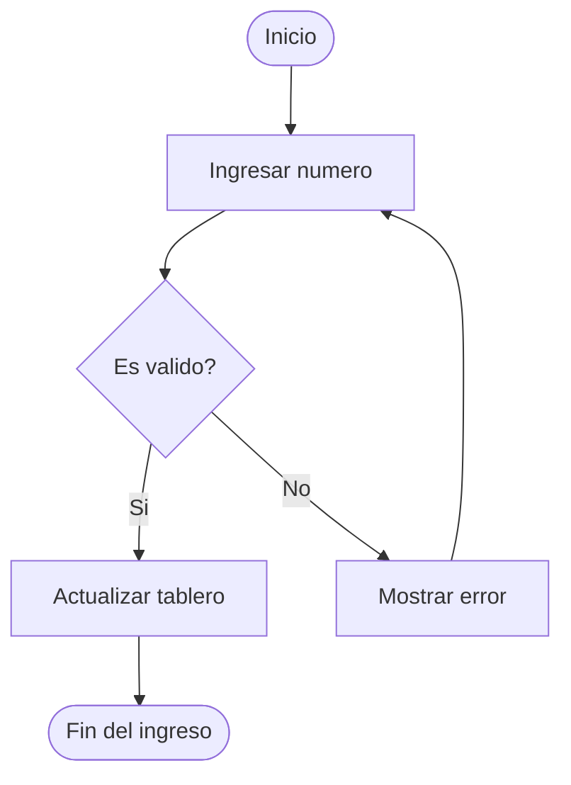
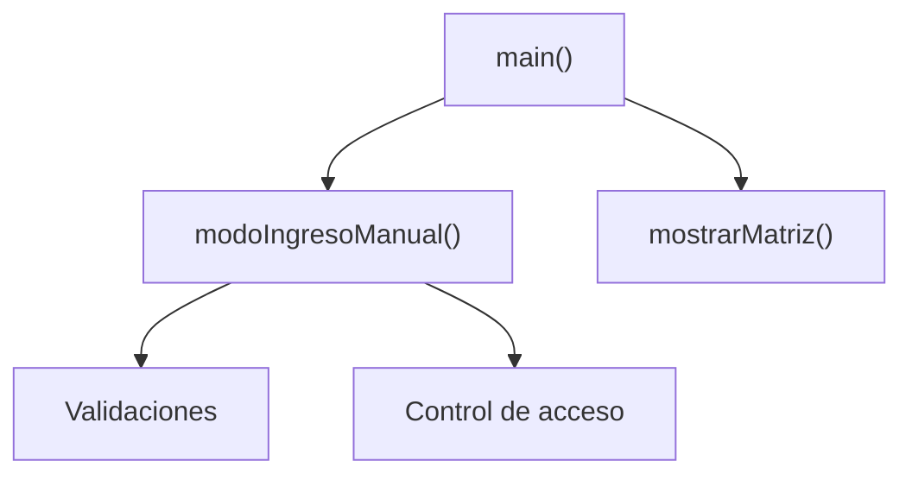
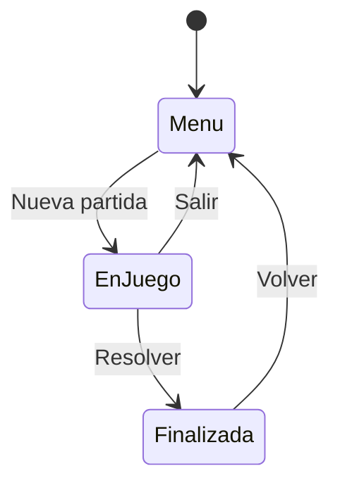
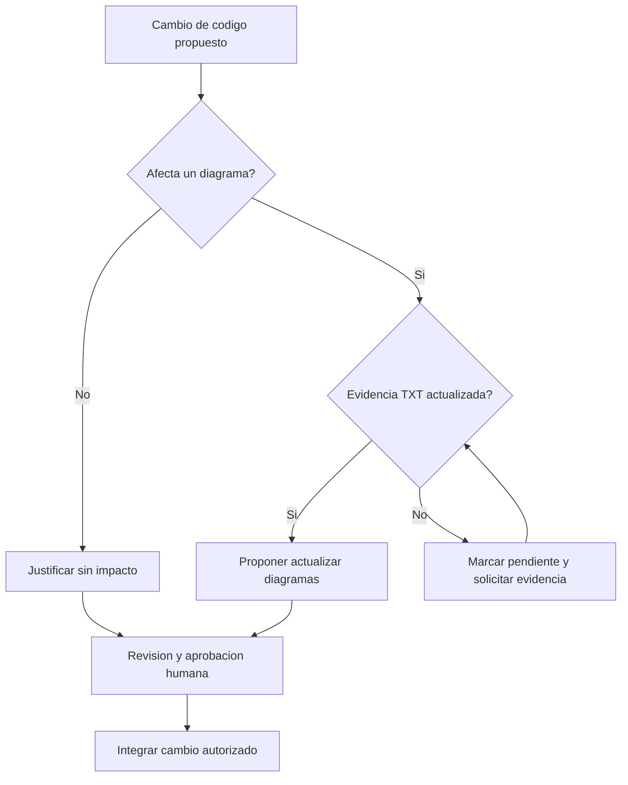

# Plan de documentación gráfica — Sodoku C++

- **Versión del plan:** 1.0 (propuesta)
- **Fecha:** 19/11/2026
- **Versión del proyecto de referencia:** v0.9.4 (pendiente de verificar)
- **Estado:** pendiente de aprobación e implementación
- **Ubicación sugerida en el repositorio:** `docs/PLAN_DIAGRAMAS.md`

## 1. Diseño de la documentación gráfica

### Objetivo

Construir una representación navegable del proyecto, desde su arquitectura general hasta los flujos de jugabilidad, sin modificar su comportamiento ni duplicar innecesariamente el código fuente. Los diagramas deben formar parte del repositorio y evolucionar junto con el software.

Usaremos Markdown y Mermaid para los diagramas lógicos; las maquetas de consola podrán utilizar bloques de texto monoespaciado. No se requieren imágenes estáticas, exportaciones ni instalaciones adicionales para visualizar Mermaid en GitHub.

### Organización propuesta

```text
Sodoku-cpp/
├── AGENTS.md                     # Reglas persistentes para Codex (crear o integrar)
└── docs/
    ├── DIRECTIVAS.md             # Existente; preservar y actualizar si se aprueba
    ├── UX.md                     # Existente; referencia de interfaz
    ├── PLAN_DIAGRAMAS.md         # Este plan
    └── diagramas/
        ├── README.md             # Índice navegable y estado de verificación
        ├── ARQUITECTURA.md       # Diagrama maestro y dependencias entre módulos
        ├── FUNCIONES.md          # Inventario y relaciones de llamadas
        ├── FLUJOS.md             # Procesos, decisiones y excepciones
        ├── ESTADOS.md            # Ciclo de vida de una partida
        └── INTERFAZ.md           # Maquetas y navegación por pantallas
```

Las rutas existentes deben confirmarse. Si ya hay documentación equivalente, integrarla en lugar de duplicarla.

| Archivo | Tipo | Qué debe documentar |
| --- | --- | --- |
| `ARQUITECTURA.md` | Arquitectura y dependencias | Punto de entrada, módulos, responsabilidades y dependencias verificadas. |
| `FUNCIONES.md` | Grafo de llamadas e inventario | Funciones por módulo, firmas, función llamadora y función llamada; identificar las entradas principales. |
| `FLUJOS.md` | Flujo, actividades y, si aporta valor, secuencia | Menú principal, nueva partida, ingreso manual, validaciones, guardado/carga, ranking y BackDoor, cuando existan y se verifiquen. |
| `ESTADOS.md` | Máquina de estados | Estados y transiciones de una partida, con condiciones y eventos reales. |
| `INTERFAZ.md` | Wireframes de consola y mapa de navegación | Pantallas, menús, mensajes, tablero y recorrido del usuario documentados en las fuentes disponibles. |

No es necesario realizar un diagrama de flujo por cada función. Las funciones auxiliares simples deben figurar en el inventario; las que concentren decisiones relevantes pueden tener un diagrama propio. El grafo de llamadas puede dividirse por módulo para evitar una red ilegible.

### Ejemplos conceptuales (no representan una auditoría)

Las siguientes relaciones son ilustrativas. No se han contrastado con un informe TXT vigente y no deben copiarse como hechos verificados.

**Arquitectura — módulos conocidos, relaciones propuestas**



**Flujo — ingreso de un número (simplificado)**



**Grafo de llamadas — ejemplo de relaciones por comprobar**



**Estados — ejemplo conceptual**



**Interfaz — maqueta ilustrativa, no captura de la aplicación**

```text
+-----------------------------------+
|              SODOKU               |
+-----------------------------------+
|  1. Nueva partida                 |
|  2. Cargar partida                |
|  3. Ranking                       |
|  0. Salir                         |
+-----------------------------------+
|  Seleccione una opcion:           |
+-----------------------------------+
```

## 2. Implementación con Codex

### Orden de trabajo y aprobación

| Fase | Entregable |
| --- | --- |
| A | Inventario de fuentes documentales, evaluación de cobertura y propuesta del diagrama maestro. |
| B | Arquitectura, inventario de funciones y grafo de llamadas. |
| C | Flujos, estados, maquetas de consola e índice navegable. |
| D | Reglas de mantenimiento, verificación y propuesta de controles en GitHub. |

La fase A es de análisis. Las fases B, C y D requieren aprobación previa. Cada fase debe revisarse antes de pasar a la siguiente. Rama sugerida (no creada): `docs/diagramas-sodoku`.

### Prompt inicial para copiar en Codex

```text
Proyecto: Sodoku-cpp.

Lee docs/PLAN_DIAGRAMAS.md y las instrucciones existentes aplicables:
AGENTS.md, docs/DIRECTIVAS.md, docs/CONVENCIONES.md y docs/UX.md,
si existen. No reemplaces sus contenidos.

Objetivo: implementar la documentacion grafica del proyecto en Markdown
con Mermaid, siguiendo el plan. Comienza solo por la fase A.

Utiliza como evidencia el informe TXT vigente que yo proporcione.
Identifica su fecha, version, cobertura y revision de codigo si consta.
No sustituyas el informe por lectura de los .cpp o .h originales sin
mi autorizacion expresa para hacerlo. Si falta informacion, marca
PENDIENTE DE VERIFICACION e indica que informe o seccion se necesita.
Si autorizo generar un nuevo TXT, debe incluir los datos requeridos
por DIRECTIVAS.md y las llamadas internas verificadas.

Presenta un inventario documental y una propuesta de diagrama maestro
con referencias exactas al TXT (archivo y lineas Lx-Ly). Indica que
relaciones son verificadas y cuales estan pendientes. No inventes
funciones, firmas, llamadas, estados, permisos ni opciones de menus.

No modifiques codigo fuente, no compiles ni ejecutes el juego o
binarios de prueba. No cambies ramas, no hagas commits, push ni PR
sin mi autorizacion. No publiques datos sensibles del BackDoor.

Antes de editar cualquier archivo, muestra los cambios propuestos,
las rutas afectadas y las referencias correspondientes. Pregunta:
¿Confirmás este cambio?

Tras mi aprobacion, avanza por fases, sin saltarte las revisiones.
Propone integrar las reglas de mantenimiento en AGENTS.md y
DIRECTIVAS.md, respetando los archivos existentes. Comprueba enlaces
y sintaxis Mermaid cuando sea posible; informa lo que no se verifico.
```

### Criterios de aceptación

- Cada diagrama tiene un objetivo claro y un enlace a sus fuentes verificables.
- Las firmas, llamadas, módulos y transiciones coinciden con el informe; las relaciones que faltan se indican como pendientes, no se presentan como hechos.
- Se verifica la correspondencia entre funciones declaradas e implementadas, así como las firmas exactas y el control de acceso según la directiva vigente; no se corrigen incidencias sin autorización.
- Se conserva el código sin modificaciones. No se compila ni se ejecuta la aplicación para esta tarea documental.
- Se revisan los enlaces relativos, la visualización Mermaid y las maquetas de consola. Si no hay un validador disponible, se deja pendiente la verificación de sintaxis/renderizado.
- Al cerrar cada revisión se informa el porcentaje de correspondencia de funciones y el número de observaciones resueltas y pendientes, o se indica que no pueden calcularse por falta de evidencia.

## 3. Mantenimiento y actualización continua

### Regla permanente propuesta para `AGENTS.md`

Integrar este bloque con las instrucciones existentes; no sobrescribir el archivo completo.

```markdown
## Documentacion grafica obligatoria

- Consulta docs/PLAN_DIAGRAMAS.md y docs/diagramas/README.md.
- Antes de cerrar un cambio, evalua su impacto en arquitectura, funciones,
  flujos, estados e interfaz. Si afecta un diagrama, propone actualizarlo
  junto con el cambio de codigo, dentro de la misma rama y PR.
- Si no afecta los diagramas, deja una justificacion concreta en el PR
  o en el resumen del cambio.
- Registra la fuente TXT, la version y la revision de codigo verificadas.
  Si el informe no cubre el cambio, marca PENDIENTE DE VERIFICACION y
  solicita evidencia actualizada. No inventes relaciones ni actualices
  fechas o revisiones aparentando una verificacion no realizada.
- Respeta DIRECTIVAS.md y solicita aprobacion antes de aplicar cambios.
- No incluyas credenciales, claves ni datos sensibles del BackDoor.
```

Si se aprueba, integrar también la obligación de mantener los diagramas en `docs/DIRECTIVAS.md`, incrementando su versión y anotando la fecha de modificación. No duplicar innecesariamente el contenido: puede referenciarse este plan.

### Trazabilidad

Cada diagrama o sección verificable debe indicar su fuente y alcance. Ejemplo de ficha (valores de muestra, no verificados):

```text
Version del programa: pendiente
Revision del codigo analizado: pendiente
Informe TXT: pendiente
Seccion y lineas: pendiente
Fecha de ultima verificacion: pendiente
Estado: PENDIENTE DE VERIFICACION
```

La revisión debe identificar el código realmente analizado, no necesariamente el último commit del repositorio, porque un commit exclusivamente documental no cambia el código del programa.

Si una función cambia, el mantenedor debe proporcionar un TXT actualizado que cubra el cambio o autorizar expresamente a Codex a regenerarlo desde el código. Si esa evidencia no existe, indicar la desactualización sin afirmar que el diagrama está vigente.

### Control en cada pull request (PR)

Integrar el siguiente checklist en `.github/pull_request_template.md` si se aprueba y respetar cualquier plantilla existente:

```markdown
## Impacto documental

- [ ] Evalue si el cambio afecta los diagramas del proyecto.
- [ ] Actualice los diagramas afectados, o justifique por que no aplica.
- [ ] Verifique que la evidencia corresponde al codigo analizado,
      o identifique lo pendiente de verificar.

Diagramas afectados / justificacion:
```

### Niveles de automatización

| Nivel | Mecanismo | Alcance |
| --- | --- | --- |
| 1 — Inicial (recomendado) | `AGENTS.md` + revisión del PR | Codex recuerda evaluar los diagramas cuando trabaja; el mantenedor revisa el resultado. No actúa por sí solo. |
| 2 — Control automático (opcional) | GitHub Actions: validación de Mermaid y aviso cuando cambian `src/` o `include/` | Detecta errores sintácticos y posibles omisiones; no garantiza la concordancia semántica con C++. Requiere diseñar y aprobar el workflow. |
| 3 — Generación asistida (opcional) | Doxygen + Graphviz para grafos de llamadas y dependencias | Regenera parte de los diagramas a partir del código si se autoriza esa lectura. No sustituye los diagramas de flujo, estados ni maquetas revisadas. |

Un cambio de código no implica necesariamente cambios gráficos: por eso no conviene exigir una edición artificial de los diagramas en cada commit. El control automático debe admitir una justificación verificable de no impacto. Ninguna automatización debe aprobar o integrar cambios por su cuenta.

### Flujo de mantenimiento



### Referencias oficiales

- OpenAI — [Iterating Development Workflows with Codex](https://developers.openai.com/cookbook/examples/codex/iterating-development-workflows-with-codex): instrucciones persistentes y planes de trabajo.
- GitHub — [Creación de diagramas en Markdown](https://docs.github.com/es/get-started/writing-on-github/working-with-advanced-formatting/creating-diagrams).
- GitHub — [Creating a pull request template](https://docs.github.com/en/communities/using-templates-to-encourage-useful-issues-and-pull-requests/creating-a-pull-request-template-for-your-repository).

---

**Estatus de cumplimiento del plan:** propuesta documental, sin auditoría de código. Correspondencia de funciones y observaciones: no calculables hasta recibir el TXT vigente. No se han creado ramas, archivos en el repositorio ni automatizaciones. Los ejemplos Mermaid no se han renderizado en GitHub en esta instancia.

**Siguiente paso:** confirmar la incorporación del plan y autorizar a Codex a realizar la fase A con el informe vigente.
