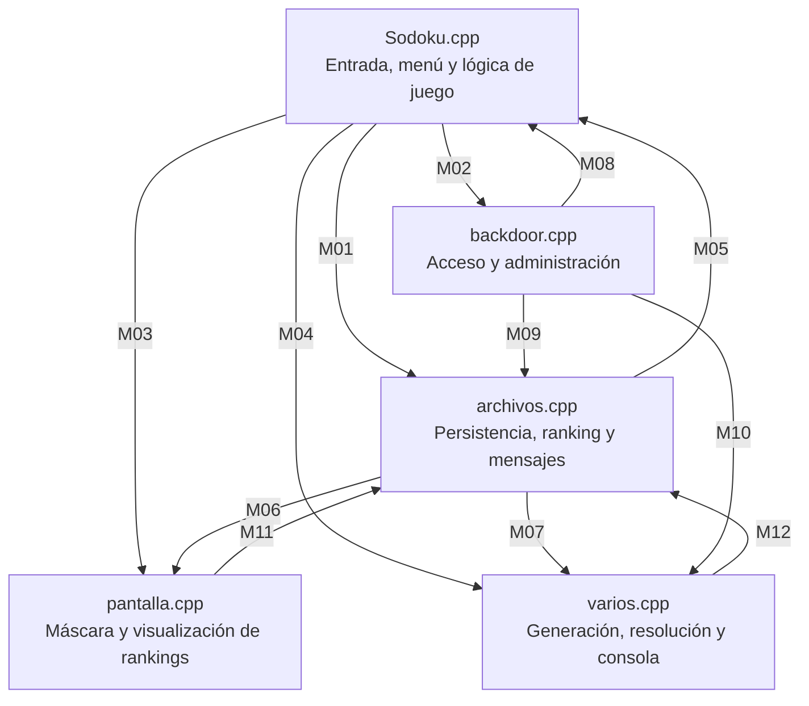
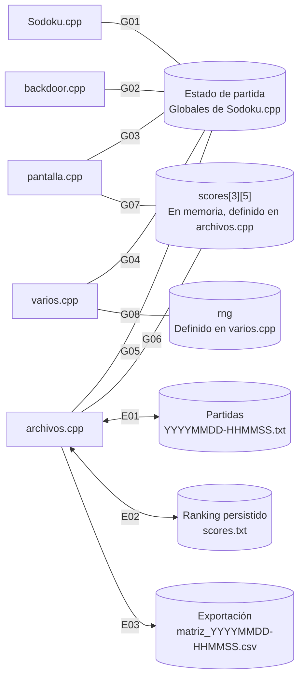

# Arquitectura de Sodoku C++

Estado: Fase A aprobada.

- Versión declarada del programa: **0.9.4**.
- Commit analizado: **`d9cc5c6904db2f79930b9d5757a04766cd67502d`**.
- Fecha del informe: **19/11/2026**.
- Fuente técnica única: [INFORME_ARQUITECTURA_SODOKU.txt, L1–L8](../informes/INFORME_ARQUITECTURA_SODOKU.txt#L1-L8).

Esta arquitectura representa la revisión identificada por el informe. Las relaciones verificadas son comprobaciones estáticas; su ejecución en cada camino y su vigencia en revisiones posteriores requieren verificación. No se reproduce material de autenticación de BackDoor.

## 1. Módulos y llamadas

Las flechas indican llamadas directas entre módulos. Los identificadores M01–M12 corresponden a la sección 5.2 del informe. Las responsabilidades proceden de la [sección 1, L75–L90](../informes/INFORME_ARQUITECTURA_SODOKU.txt#L75-L90).

| Relación verificada | Ejemplos de llamadas | Referencia exacta al informe |
| --- | --- | --- |
| M01: Sodoku → archivos | Guardar/cargar partida, actualizar ranking y mostrar mensajes | §5.2, [L820–L832](../informes/INFORME_ARQUITECTURA_SODOKU.txt#L820-L832) |
| M02: Sodoku → backdoor | `validarNivelDeAcceso`, `subMenuBackDoor` | §5.2, [L833–L839](../informes/INFORME_ARQUITECTURA_SODOKU.txt#L833-L839) |
| M03: Sodoku → pantalla | `limpiarMascara`, marcado de coordenadas, `mostrarScores` | §5.2, [L840–L851](../informes/INFORME_ARQUITECTURA_SODOKU.txt#L840-L851) |
| M04: Sodoku → varios | Generación, resolución y utilidades de consola | §5.2, [L852–L891](../informes/INFORME_ARQUITECTURA_SODOKU.txt#L852-L891) |
| M05: archivos → Sodoku | `cargarPartidaDesdeArchivo` → `mostrarMatriz` | §5.2, [L892–L893](../informes/INFORME_ARQUITECTURA_SODOKU.txt#L892-L893) |
| M06: archivos → pantalla | `cargarPartidaDesdeArchivo` → `limpiarMascara` | §5.2, [L894–L895](../informes/INFORME_ARQUITECTURA_SODOKU.txt#L894-L895) |
| M07: archivos → varios | Colores, restauración de color y `MSGPAUSA` | §5.2, [L896–L908](../informes/INFORME_ARQUITECTURA_SODOKU.txt#L896-L908) |
| M08: backdoor → Sodoku | Mostrar, limpiar y fijar el tablero | §5.2, [L909–L912](../informes/INFORME_ARQUITECTURA_SODOKU.txt#L909-L912) |
| M09: backdoor → archivos | Validación, guardado, borrado de ranking y exportación | §5.2, [L913–L918](../informes/INFORME_ARQUITECTURA_SODOKU.txt#L913-L918) |
| M10: backdoor → varios | Consola, colores y pausas | §5.2, [L919–L927](../informes/INFORME_ARQUITECTURA_SODOKU.txt#L919-L927) |
| M11: pantalla → archivos | `mostrarScores` → `cargarScores` | §5.2, [L928–L929](../informes/INFORME_ARQUITECTURA_SODOKU.txt#L928-L929) |
| M12: varios → archivos | `generarTableroAleatorio` → `mostrarError` | §5.2, [L930–L931](../informes/INFORME_ARQUITECTURA_SODOKU.txt#L930-L931) |

Las inclusiones locales directas constituyen dependencias de compilación adicionales a las llamadas:

| Unidad | Cabeceras locales incluidas | Referencia exacta al informe |
| --- | --- | --- |
| `Sodoku.cpp` | `Sodoku.h`, `archivos.h`, `backdoor.h`, `constantes.h`, `pantalla.h`, `varios.h` | §5.1, [L776–L782](../informes/INFORME_ARQUITECTURA_SODOKU.txt#L776-L782) |
| `archivos.cpp` | `Sodoku.h`, `archivos.h`, `backdoor.h`, `constantes.h`, `pantalla.h`, `varios.h` | §5.1, [L785–L791](../informes/INFORME_ARQUITECTURA_SODOKU.txt#L785-L791) |
| `backdoor.cpp` | `Sodoku.h`, `archivos.h`, `constantes.h`, `pantalla.h`, `varios.h` | §5.1, [L794–L799](../informes/INFORME_ARQUITECTURA_SODOKU.txt#L794-L799) |
| `pantalla.cpp` | `Sodoku.h`, `archivos.h`, `constantes.h`, `pantalla.h`, `varios.h` | §5.1, [L804–L809](../informes/INFORME_ARQUITECTURA_SODOKU.txt#L804-L809) |
| `varios.cpp` | `Sodoku.h`, `archivos.h`, `constantes.h`, `varios.h` | §5.1, [L812–L816](../informes/INFORME_ARQUITECTURA_SODOKU.txt#L812-L816) |

Las dependencias entre cabeceras están inventariadas en [§5.1, L772–L818](../informes/INFORME_ARQUITECTURA_SODOKU.txt#L772-L818). Incluir una cabecera no demuestra una llamada: BackDoor incluye `pantalla.h`, pero el informe no registra una llamada directa de `backdoor.cpp` a `pantalla.cpp`. Los ciclos entre módulos están descritos en [§5.4, L945–L954](../informes/INFORME_ARQUITECTURA_SODOKU.txt#L945-L954).

## 2. Persistencia y estado compartido

En este diagrama, las líneas sin flecha representan acceso a datos en memoria. Las flechas dobles indican lectura y escritura de archivos; la flecha de CSV indica exportación. Los identificadores G y E se definen en la tabla siguiente y no son símbolos del programa.

| Relaciones verificadas | Alcance | Referencia exacta al informe |
| --- | --- | --- |
| G01–G05 | Los cinco módulos acceden a datos del tablero o de la máscara; otros indicadores se detallan debajo | §6, [L973–L1020](../informes/INFORME_ARQUITECTURA_SODOKU.txt#L973-L1020) |
| G06–G07 | `archivos.cpp` administra `scores`; `pantalla.cpp` lo utiliza para presentarlo | §6, [L1021–L1023](../informes/INFORME_ARQUITECTURA_SODOKU.txt#L1021-L1023) |
| G08 | El generador aleatorio se utiliza en la mezcla de posiciones y en el resolvedor | §6, [L1024–L1026](../informes/INFORME_ARQUITECTURA_SODOKU.txt#L1024-L1026) |
| E01 | Guardado y carga de partidas | §7.7–§7.8, [L1124–L1151](../informes/INFORME_ARQUITECTURA_SODOKU.txt#L1124-L1151); formato en §8.2, [L1212–L1228](../informes/INFORME_ARQUITECTURA_SODOKU.txt#L1212-L1228) |
| E02 | Lectura, actualización en memoria y persistencia del ranking | §7.10, [L1166–L1177](../informes/INFORME_ARQUITECTURA_SODOKU.txt#L1166-L1177); formato en §8.3, [L1230–L1237](../informes/INFORME_ARQUITECTURA_SODOKU.txt#L1230-L1237) |
| E03 | Exportación de `MATRIZ` a CSV | §8.4, [L1239–L1244](../informes/INFORME_ARQUITECTURA_SODOKU.txt#L1239-L1244) |

Las rutas de partidas, rankings y CSV son relativas al directorio de trabajo del proceso, según [§8.1, L1201–L1210](../informes/INFORME_ARQUITECTURA_SODOKU.txt#L1201-L1210). No se presupone que los archivos se almacenen siempre en `src/`.

La consulta de ranking recarga datos en memoria sin crear el archivo ausente. `guardarScores()` conserva la capacidad de crear o sobrescribir el archivo cuando se solicita persistencia: [§7.10, L1166–L1177](../informes/INFORME_ARQUITECTURA_SODOKU.txt#L1166-L1177).

### Datos globales representados

| Grupo | Variables | Referencia exacta al informe |
| --- | --- | --- |
| Tablero y máscara | `MATRIZ`, `SOLUCION`, `CELDAFIJA`, `MASCARA` | §6, [L973–L984](../informes/INFORME_ARQUITECTURA_SODOKU.txt#L973-L984) |
| Presentación | `CARACTERPAUSA` | §6, [L985–L987](../informes/INFORME_ARQUITECTURA_SODOKU.txt#L985-L987) |
| Partida y reanudación | `partidaEnCurso`, `nivelCargado`, `SODOKU_RESUELTO`, `esPartidaNueva` | §6, [L991–L999](../informes/INFORME_ARQUITECTURA_SODOKU.txt#L991-L999) y [L1012–L1014](../informes/INFORME_ARQUITECTURA_SODOKU.txt#L1012-L1014) |
| Modo y permisos | `modoPruebasHabilitado`, `modoCompetitivo`, `resolucionAutomaticaHabilitada` | §6, [L1000–L1008](../informes/INFORME_ARQUITECTURA_SODOKU.txt#L1000-L1008) |
| Intentos y tiempo | `endGame`, `intentosFallidos`, `tsSesionInicio`, `duracionAcumulada` | §6, [L988–L990](../informes/INFORME_ARQUITECTURA_SODOKU.txt#L988-L990), [L1009–L1011](../informes/INFORME_ARQUITECTURA_SODOKU.txt#L1009-L1011) y [L1015–L1020](../informes/INFORME_ARQUITECTURA_SODOKU.txt#L1015-L1020) |
| Ranking y aleatoriedad | `scores`, `rng` | §6, [L1021–L1026](../informes/INFORME_ARQUITECTURA_SODOKU.txt#L1021-L1026) |

El acceso compartido no atribuye a cada módulo escritura sobre todas las variables del grupo. El informe distingue las referencias nominales de las mutaciones transitivas por parámetros: [§6, L1032–L1035](../informes/INFORME_ARQUITECTURA_SODOKU.txt#L1032-L1035).

## 3. Verificación y pendientes

**Verificado en el informe:** los cinco módulos, los 12 pares de llamadas M01–M12, las relaciones de persistencia y las referencias de estado compartido representadas. Las flechas no implican que todas las ramas se ejecuten en una misma partida.

**Pendiente de verificación:**

- Comportamiento en ejecución por plataforma, terminal y combinación de opciones: [§13, L1614–L1620](../informes/INFORME_ARQUITECTURA_SODOKU.txt#L1614-L1620).
- Integridad de archivos ante fallos de persistencia: [§8.4, L1239–L1244](../informes/INFORME_ARQUITECTURA_SODOKU.txt#L1239-L1244).
- Clasificación exhaustiva de efectos por alias y parámetros de arreglos: [§6, L1032–L1035](../informes/INFORME_ARQUITECTURA_SODOKU.txt#L1032-L1035).
- Vigencia de estas relaciones para revisiones posteriores al commit analizado: [§15, L1654–L1662](../informes/INFORME_ARQUITECTURA_SODOKU.txt#L1654-L1662).

No se dibujan llamadas hipotéticas para completar esos pendientes. Los estados de partida descritos por el informe requieren condiciones y banderas específicas; este documento no desarrolla todavía una máquina de estados.

La correspondencia estática registrada es de **50/50 firmas únicas** y **52/52 declaraciones compatibles**, ambas del 100 %, sin equivaler a cobertura funcional: [§13, L1570–L1582](../informes/INFORME_ARQUITECTURA_SODOKU.txt#L1570-L1582). El informe mantiene **18 observaciones abiertas**; este documento no las corrige ni las cierra: [§13, L1600–L1604](../informes/INFORME_ARQUITECTURA_SODOKU.txt#L1600-L1604).

La Fase A fue aprobada. El inicio de la Fase B requiere autorización previa.
