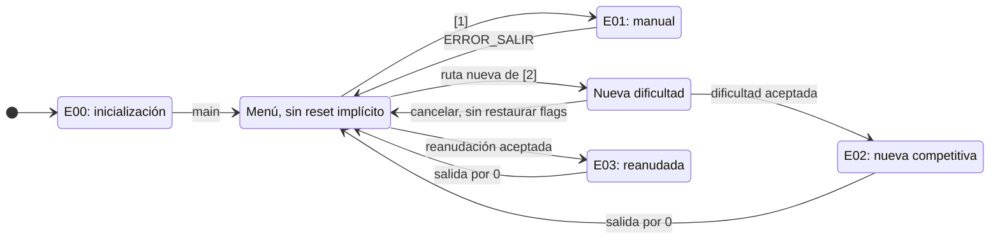
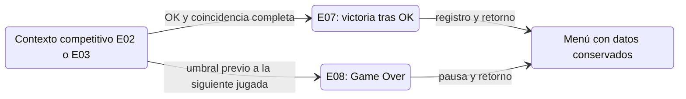
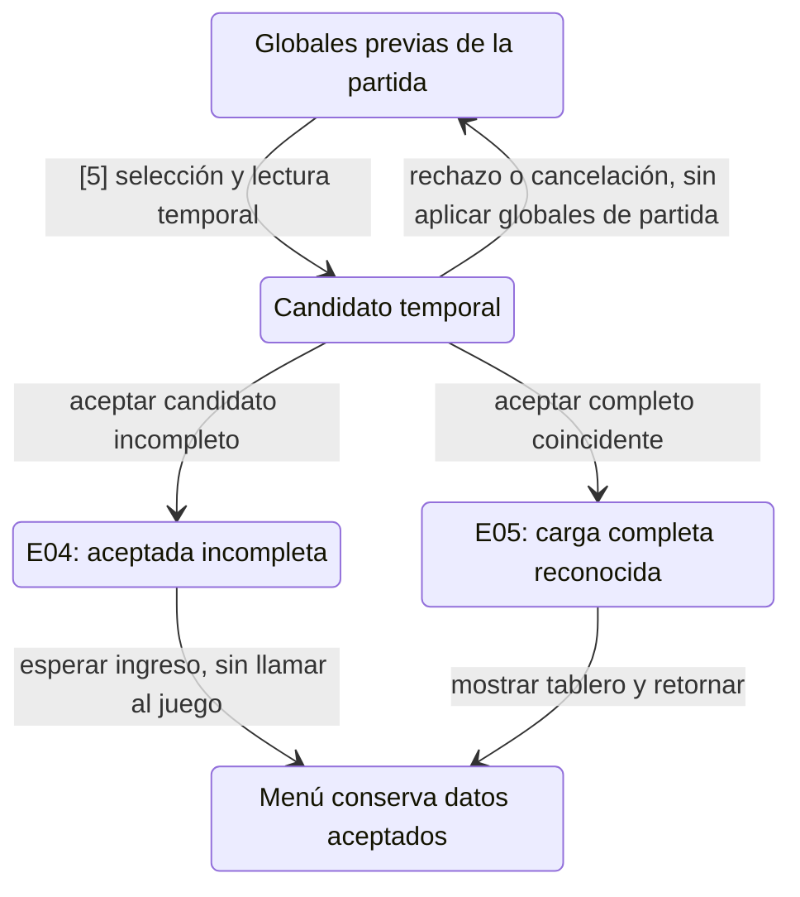
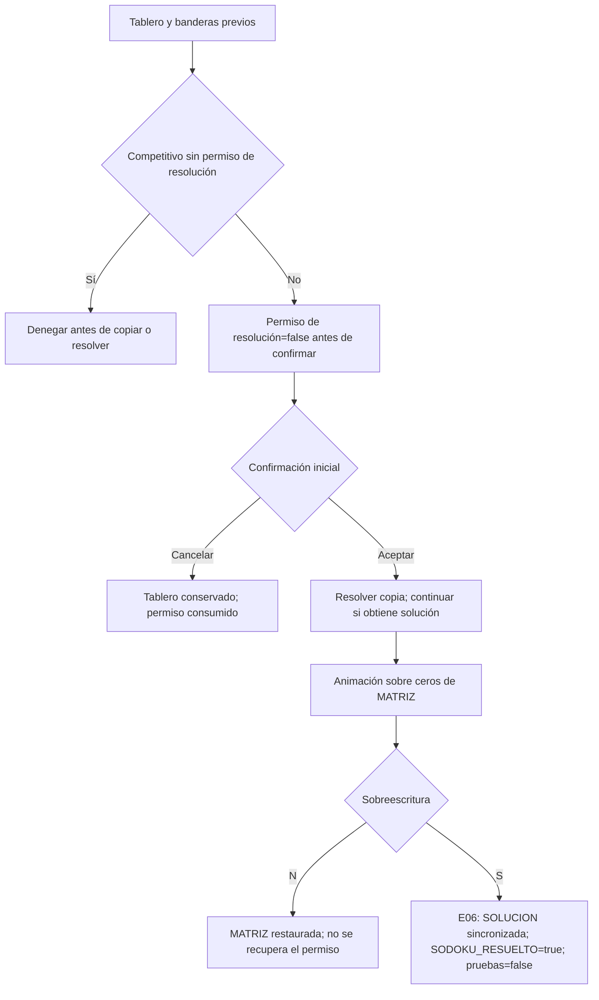
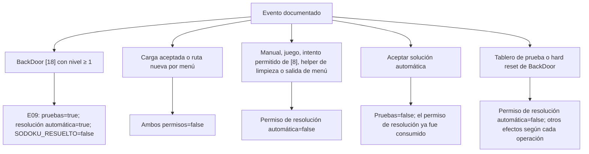
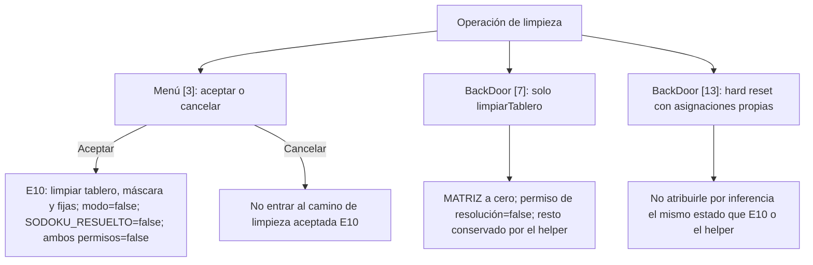

# Estados de las partidas — Sodoku C++ v0.9.4

Estado: Fase C aprobada.

- Base documental de trabajo: `docs/diagramas-sodoku`, commit **`79dd75bf9df0b7b4fce640ec0ec64482b82aec60`**.
- Evidencia **H**: informe histórico del **19/11/2026**, código **`d9cc5c6904db2f79930b9d5757a04766cd67502d`**; [H metadatos, L1–L8](../informes/INFORME_ARQUITECTURA_SODOKU.txt#L1-L8).
- Evidencia **I**: informe incremental del **24/11/2026**, código contrastado **`5c48cd4889ee3c94813ffea99269ae95ff6b80ee`**; [I §0, L7–L27](../informes/INFORME_ACTUALIZACION_ARQUITECTURA_5c48cd4.txt#L7-L27).
- Fuentes técnicas exclusivas: esos dos TXT. Las referencias H conservan sus líneas históricas; I aporta la correspondencia actual de `varios.cpp`, con firmas y relaciones conservadas ([I §3–5, L108–L253](../informes/INFORME_ACTUALIZACION_ARQUITECTURA_5c48cd4.txt#L108-L253)).

**COMPROBADO ESTÁTICAMENTE** identifica un camino o una asignación descritos por los informes. No acredita ejecución, comportamiento de una terminal ni exhaustividad de todas las combinaciones. **PENDIENTE** conserva los riesgos, la información no transcrita y los controles que necesitan verificación. Los nombres de vistas de este documento son identificadores documentales, no símbolos agregados al programa ([H §0, L39–L58](../informes/INFORME_ARQUITECTURA_SODOKU.txt#L39-L58)).

## 1. Modelo descriptivo y ejes separados

`E00`–`E10` son las etiquetas del informe histórico, no un `enum` ni una máquina única implementada. Pantalla, contenido del tablero, modo protegido, reanudación, resolución, permisos e intentos/tiempo son ejes distintos. Un mismo tablero puede verse desde el menú o desde ingreso manual sin perder su contexto competitivo ([H §9, L1246–L1262](../informes/INFORME_ARQUITECTURA_SODOKU.txt#L1246-L1262)).

Las vistas siguientes son proyecciones parciales de esos ejes. Volver al nodo «Menú» no representa reinicialización global ni transición a E00. E09 es una concesión de permisos que puede coexistir con otros estados de datos, no un estado exclusivo del tablero.

## 2. Variables y condiciones que deben distinguirse

| Variable o condición | Significado documentado | Evidencia |
| --- | --- | --- |
| `MATRIZ`, `SOLUCION`, `CELDAFIJA`, `MASCARA` | Tablero actual, solución objetivo, protección de celdas y presentación; no son intercambiables. | [H §6, L973–L984](../informes/INFORME_ARQUITECTURA_SODOKU.txt#L973-L984) |
| `modoCompetitivo` | Contexto que protege `[8]` y determina el nivel guardado; `[1]` no lo vuelve libre. | [H §6, L1003–L1005](../informes/INFORME_ARQUITECTURA_SODOKU.txt#L1003-L1005) |
| `partidaEnCurso` | Indicador de reanudación con transiciones no uniformes; no certifica que el bucle esté ejecutándose. | [H §6, L991–L993](../informes/INFORME_ARQUITECTURA_SODOKU.txt#L991-L993); [H §9, L1263–L1271](../informes/INFORME_ARQUITECTURA_SODOKU.txt#L1263-L1271) |
| `nivelCargado` | Dificultad interna 0..2; `-1` indica ausencia de dificultad asignada en varios caminos. No es el rol de BackDoor. | [H §6, L994–L996](../informes/INFORME_ARQUITECTURA_SODOKU.txt#L994-L996) |
| `esPartidaNueva` y `esReanudar` | El primer indicador se consume al ingresar al juego; el segundo es una copia local del indicador de curso. | [H §6, L1012–L1014](../informes/INFORME_ARQUITECTURA_SODOKU.txt#L1012-L1014); [H §7.4, L1085–L1093](../informes/INFORME_ARQUITECTURA_SODOKU.txt#L1085-L1093) |
| `SODOKU_RESUELTO` | Indicador usado por resolución/carga; no equivale universalmente a victoria ni a tablero completo. | [H §6, L997–L999](../informes/INFORME_ARQUITECTURA_SODOKU.txt#L997-L999); [H §11, L1383–L1386](../informes/INFORME_ARQUITECTURA_SODOKU.txt#L1383-L1386) |
| `modoPruebasHabilitado` | Permite solicitar confirmación para entrar a `[2]` con tablero completo. | [H §6, L1000–L1002](../informes/INFORME_ARQUITECTURA_SODOKU.txt#L1000-L1002) |
| `resolucionAutomaticaHabilitada` | Excepción administrativa de un intento para `[8]`, distinta del permiso anterior. | [H §6, L1006–L1008](../informes/INFORME_ARQUITECTURA_SODOKU.txt#L1006-L1008) |
| Completitud comparada | Ausencia de ceros y coincidencia de `MATRIZ` con `SOLUCION` en la comprobación correspondiente. | [H §7.3, L1071–L1083](../informes/INFORME_ARQUITECTURA_SODOKU.txt#L1071-L1083); [H §9, L1276–L1290](../informes/INFORME_ARQUITECTURA_SODOKU.txt#L1276-L1290) |
| `intentosFallidos`, `endGame` | Errores lógicos y umbral; Game Over se evalúa antes de la próxima jugada con `endGame>0 && intentosFallidos>=endGame`. | [H §6, L988–L990](../informes/INFORME_ARQUITECTURA_SODOKU.txt#L988-L990); [H §7.6, L1112–L1122](../informes/INFORME_ARQUITECTURA_SODOKU.txt#L1112-L1122) |
| `tsSesionInicio`, `duracionAcumulada` | Tiempo de sesión y acumulador en memoria; el guardado no serializa ese acumulador como duración real. | [H §6, L1015–L1020](../informes/INFORME_ARQUITECTURA_SODOKU.txt#L1015-L1020); [H §11, L1392–L1401](../informes/INFORME_ARQUITECTURA_SODOKU.txt#L1392-L1401) |

## 3. Catálogo de estados del TXT

| ID | Contexto o estado descrito | Banderas y límites comprobados estáticamente | Evidencia |
| --- | --- | --- | --- |
| E00 | Inicializado / menú inicial | Inicialización estática, máscara limpiada, nivel `-1`, banderas inicialmente `false` y fallos cero. No describe todos los retornos posteriores al menú. | [H §9, L1254–L1257](../informes/INFORME_ARQUITECTURA_SODOKU.txt#L1254-L1257) |
| E01 | Interacción manual `[1]` | Puede operar sobre datos libres o competitivos; revoca el permiso de resolución al entrar y salir. No prueba victoria ni registra ranking. | [H §9, L1258–L1262](../informes/INFORME_ARQUITECTURA_SODOKU.txt#L1258-L1262); [H §7.2, L1063–L1069](../informes/INFORME_ARQUITECTURA_SODOKU.txt#L1063-L1069) |
| E02 | Nueva competitiva activa | `modoCompetitivo=true`, dificultad 0..2; consume nueva partida y pone `partidaEnCurso=true` al generar. | [H §9, L1263–L1266](../informes/INFORME_ARQUITECTURA_SODOKU.txt#L1263-L1266) |
| E03 | Ingreso por reanudación | Copia `true` a `esReanudar`, baja `partidaEnCurso=false` y omite la rama que la restablece. ARQ-01 continúa pendiente. | [H §9, L1267–L1271](../informes/INFORME_ARQUITECTURA_SODOKU.txt#L1267-L1271) |
| E04 | Carga incompleta aceptada, esperando ingreso | Normalmente el candidato de curso es `true`; `esPartidaNueva=false`; modo por `Nivel` original. Los datos internos dependen del bloque opcional. No se convierte «normalmente» en un invariante absoluto. | [H §9, L1272–L1275](../informes/INFORME_ARQUITECTURA_SODOKU.txt#L1272-L1275) |
| E05 | Completa reconocida durante carga | No hay ceros y coincide con solución; `partidaEnCurso=false`; se muestra el tablero. No fuerza siempre `SODOKU_RESUELTO=true` ni `esPartidaNueva=false` en esa rama. | [H §9, L1276–L1280](../informes/INFORME_ARQUITECTURA_SODOKU.txt#L1276-L1280) |
| E06 | Solución automática aceptada | Sincroniza solución; `SODOKU_RESUELTO=true`, pruebas `false`, permiso de resolución consumido. Conserva el modo previo. | [H §9, L1281–L1285](../informes/INFORME_ARQUITECTURA_SODOKU.txt#L1281-L1285) |
| E07 | Victoria tras jugada | Comparación posterior a `OK`; registro de score y curso `false`. Ese bloque no asigna `SODOKU_RESUELTO=true`. | [H §9, L1286–L1290](../informes/INFORME_ARQUITECTURA_SODOKU.txt#L1286-L1290) |
| E08 | Game Over | Umbral de fallos alcanzado con límite positivo; curso `false`; conserva tablero, modo y fallos; resume y acumula duración. | [H §9, L1291–L1294](../informes/INFORME_ARQUITECTURA_SODOKU.txt#L1291-L1294) |
| E09 | Excepción administrativa | `[18]` con nivel permitido pone `SODOKU_RESUELTO=false` y concede ambos permisos. No define un único «modo de pruebas» que sustituya esos dos permisos. | [H §9, L1295–L1299](../informes/INFORME_ARQUITECTURA_SODOKU.txt#L1295-L1299) |
| E10 | Limpieza explícita del menú | `[3]` limpia tablero, máscara y fijas; pone modo, resolución y pruebas en `false`; el helper revoca resolución automática. No reinicia todas las globales. | [H §9, L1300–L1306](../informes/INFORME_ARQUITECTURA_SODOKU.txt#L1300-L1306) |

### ED-01. Contexto de interacción, nueva partida y reanudación

COMPROBADO ESTÁTICAMENTE; alcance: [H §9, L1254–L1271](../informes/INFORME_ARQUITECTURA_SODOKU.txt#L1254-L1271); [H §9, L1286–L1294](../informes/INFORME_ARQUITECTURA_SODOKU.txt#L1286-L1294); [H §9, L1308–L1323](../informes/INFORME_ARQUITECTURA_SODOKU.txt#L1308-L1323); [H §11, L1372–L1382](../informes/INFORME_ARQUITECTURA_SODOKU.txt#L1372-L1382).

Esta vista omite carga, resolución y submenús para separar los ejes. Las condiciones de ingreso a `[2]` siguen siendo las de FL-03 en [FLUJOS.md](FLUJOS.md). La copia local `esReanudar` no es una variable global nueva. No hay una transición de victoria solo por entrar a un tablero completo.

### ED-01B. Finales del contexto competitivo

COMPROBADO ESTÁTICAMENTE; alcance: [H §7.6, L1112–L1122](../informes/INFORME_ARQUITECTURA_SODOKU.txt#L1112-L1122); [H §9, L1286–L1294](../informes/INFORME_ARQUITECTURA_SODOKU.txt#L1286-L1294); [H §9, L1318–L1320](../informes/INFORME_ARQUITECTURA_SODOKU.txt#L1318-L1320).

Agrupar E02/E03 en la entrada de esta proyección solo permite mostrar los finales comunes; no iguala sus banderas de reanudación. La victoria no asigna por ese bloque `SODOKU_RESUELTO=true`; Game Over no borra el tablero ni reinicia los fallos. El límite positivo y el umbral se detallan en la tabla de variables y en FL-05.

### ED-02. Candidato de carga y preservación ante rechazo

COMPROBADO ESTÁTICAMENTE; alcance: [H §7.8, L1133–L1150](../informes/INFORME_ARQUITECTURA_SODOKU.txt#L1133-L1150); [H §9, L1272–L1280](../informes/INFORME_ARQUITECTURA_SODOKU.txt#L1272-L1280); [H §9, L1314–L1315](../informes/INFORME_ARQUITECTURA_SODOKU.txt#L1314-L1315).

La preservación se refiere al estado global de la partida; `cin`, mensajes y pausas pueden cambiar. Al aceptar, se revocan ambos permisos y el modo se deriva de `Nivel` original: libre y fácil no se confunden por compartir índice normalizado 0. El campo opcional `VICTORIA` de la rama no completa no se representa como prueba de que el tablero sea válido o esté completo. `INICIO` y `DURACION_S` no se restauran ([H §8.2, L1212–L1228](../informes/INFORME_ARQUITECTURA_SODOKU.txt#L1212-L1228)).

### ED-03. Cancelación y aceptación de resolución automática

COMPROBADO ESTÁTICAMENTE; alcance: [H §7.9, L1152–L1164](../informes/INFORME_ARQUITECTURA_SODOKU.txt#L1152-L1164); [H §9, L1281–L1285](../informes/INFORME_ARQUITECTURA_SODOKU.txt#L1281-L1285); [H §9, L1316–L1317](../informes/INFORME_ARQUITECTURA_SODOKU.txt#L1316-L1317).

El grafo representa la ruta de copia resuelta; el fallo del resolvedor no se convierte en aceptación. E05, E06 y E07 son tres situaciones distintas: carga completa, resolución automática y victoria por jugada no asignan las mismas banderas. No se reemplazan por un único estado «resuelto» (ARQ-03). Resolver no cambia el modo ni registra ranking.

### ED-04. Asignaciones de permisos como eje independiente

COMPROBADO ESTÁTICAMENTE; alcance: [H §9, L1295–L1299](../informes/INFORME_ARQUITECTURA_SODOKU.txt#L1295-L1299); [H §9, L1325–L1336](../informes/INFORME_ARQUITECTURA_SODOKU.txt#L1325-L1336); [H §7.1, L1057–L1061](../informes/INFORME_ARQUITECTURA_SODOKU.txt#L1057-L1061).

Este diagrama agrupa eventos por asignación documentada; no impone un orden ni inventa combinaciones alcanzables de los dos booleanos. Un tablero completo con permiso de pruebas puede entrar por `[2]` tras aceptar `S`; `N` conserva el estado de esa rama, y la victoria requiere una jugada posterior ([H §9, L1321–L1322](../informes/INFORME_ARQUITECTURA_SODOKU.txt#L1321-L1322)).

| Evento | Efecto documentado que debe conservarse | Evidencia |
| --- | --- | --- |
| `[18]` permitido | Concede ambos permisos y baja `SODOKU_RESUELTO`. | [H §9, L1295–L1299](../informes/INFORME_ARQUITECTURA_SODOKU.txt#L1295-L1299) |
| Carga aceptada | Ambos permisos `false`; una carga rechazada no pasa por esa aplicación. | [H §9, L1325–L1326](../informes/INFORME_ARQUITECTURA_SODOKU.txt#L1325-L1326) |
| Nueva partida por menú | Ambos `false` antes del selector; cancelar puede conservar esa revocación. | [H §9, L1327–L1327](../informes/INFORME_ARQUITECTURA_SODOKU.txt#L1327-L1327); [H §11, L1377–L1382](../informes/INFORME_ARQUITECTURA_SODOKU.txt#L1377-L1382) |
| Limpieza del menú | El helper revoca resolución y el menú revoca pruebas. | [H §9, L1328–L1328](../informes/INFORME_ARQUITECTURA_SODOKU.txt#L1328-L1328) |
| Entrar y volver del juego | Resolución `false` en entrada y sitios de retorno citados. | [H §9, L1329–L1330](../informes/INFORME_ARQUITECTURA_SODOKU.txt#L1329-L1330) |
| Entrar y salir de manual | Resolución `false`; el contexto competitivo no se elimina por ello. | [H §9, L1331–L1331](../informes/INFORME_ARQUITECTURA_SODOKU.txt#L1331-L1331); [H §7.2, L1063–L1069](../informes/INFORME_ARQUITECTURA_SODOKU.txt#L1063-L1069) |
| Intentar `[8]` en camino permitido | Consume resolución antes de confirmar; no se devuelve al cancelar. | [H §9, L1332–L1332](../informes/INFORME_ARQUITECTURA_SODOKU.txt#L1332-L1332) |
| Aceptar solución automática | Pruebas `false`. | [H §9, L1333–L1333](../informes/INFORME_ARQUITECTURA_SODOKU.txt#L1333-L1333) |
| Tablero de prueba y hard reset | Resolución `false`; no equivalen a la limpieza del menú. | [H §9, L1334–L1336](../informes/INFORME_ARQUITECTURA_SODOKU.txt#L1334-L1336) |
| Salir del menú principal | Revoca permiso de resolución. | [H §7.1, L1057–L1061](../informes/INFORME_ARQUITECTURA_SODOKU.txt#L1057-L1061) |

### ED-05. Limpiezas distintas y transición a E10

COMPROBADO ESTÁTICAMENTE; alcance: [H §3, L149–L153](../informes/INFORME_ARQUITECTURA_SODOKU.txt#L149-L153); [H §9, L1300–L1306](../informes/INFORME_ARQUITECTURA_SODOKU.txt#L1300-L1306); [H §9, L1323–L1323](../informes/INFORME_ARQUITECTURA_SODOKU.txt#L1323-L1323); [H §11, L1387–L1391](../informes/INFORME_ARQUITECTURA_SODOKU.txt#L1387-L1391).

La guardia de cada herramienta administrativa sigue siendo la descrita para BackDoor; el diagrama no la elimina ni amplía a todas las rutas públicas. No se inventan las asignaciones del hard reset que el TXT no enumera exhaustivamente en este apartado.

## 4. Limpieza, tiempo y persistencia parcial

`limpiarTablero()` pone `MATRIZ` a cero y revoca resolución automática, conservando el resto del estado según su ficha. `[3]` añade limpieza de máscara/fijas y cambios de modo/resolución/pruebas. BackDoor `[7]` llama al helper y `[13]` realiza otro conjunto de asignaciones. No se atribuye a esas tres operaciones un reset común de solución, nivel, fallos y tiempo ([H §3, L149–L153](../informes/INFORME_ARQUITECTURA_SODOKU.txt#L149-L153); [H §9, L1300–L1306](../informes/INFORME_ARQUITECTURA_SODOKU.txt#L1300-L1306); [H §11, L1387–L1396](../informes/INFORME_ARQUITECTURA_SODOKU.txt#L1387-L1396)).

Guardar no es una transición que serialice toda la sesión. `VICTORIA` deriva de `SODOKU_RESUELTO`, `INICIO` se toma al guardar y `DURACION_S` es 0; los permisos no se serializan y esos tiempos no se restauran al cargar. No se dibuja «reanudar = recuperar exactamente toda la sesión» ([H §8.2, L1212–L1228](../informes/INFORME_ARQUITECTURA_SODOKU.txt#L1212-L1228)).

## Registro de los 19 pendientes conservados

Todos los registros siguientes permanecen **PENDIENTES**. Que un aspecto esté comprobado estáticamente no cierra su observación ni demuestra su impacto en ejecución. Se conservan las 18 observaciones heredadas (13 P2 y 5 P3) y una incidencia independiente; no se crean issues ni se considera duplicada la incidencia nueva ([I §7–8, L279–L322](../informes/INFORME_ACTUALIZACION_ARQUITECTURA_5c48cd4.txt#L279-L322)).

| Registro | Prioridad heredada | Observación o incidencia | Evidencia |
| --- | --- | --- | --- |
| ARQ-01 · PENDIENTE | P2 | Reanudación con bandera no uniforme. | [H §11, L1372–L1376](../informes/INFORME_ARQUITECTURA_SODOKU.txt#L1372-L1376) |
| ARQ-02 · PENDIENTE | P2 | Cancelar dificultad no conserva todos los flags. | [H §11, L1377–L1382](../informes/INFORME_ARQUITECTURA_SODOKU.txt#L1377-L1382) |
| ARQ-03 · PENDIENTE | P2 | "Resuelto" no tiene un indicador único. | [H §11, L1383–L1386](../informes/INFORME_ARQUITECTURA_SODOKU.txt#L1383-L1386) |
| ARQ-04 · PENDIENTE | P2 | Variantes de limpieza conservan datos distintos. | [H §11, L1387–L1391](../informes/INFORME_ARQUITECTURA_SODOKU.txt#L1387-L1391) |
| ARQ-05 · PENDIENTE | P2 | Persistencia parcial del tiempo y estadísticas. | [H §11, L1392–L1396](../informes/INFORME_ARQUITECTURA_SODOKU.txt#L1392-L1396) |
| ARQ-06 · PENDIENTE | P2 | Punteros de localtime. | [H §11, L1397–L1401](../informes/INFORME_ARQUITECTURA_SODOKU.txt#L1397-L1401) |
| ARQ-07 · PENDIENTE | P2 | Formato y coherencia no uniformes. | [H §11, L1402–L1410](../informes/INFORME_ARQUITECTURA_SODOKU.txt#L1402-L1410) |
| ARQ-08 · PENDIENTE | P2 | Validadores y resolvedor no son sanitizadores. | [H §11, L1411–L1417](../informes/INFORME_ARQUITECTURA_SODOKU.txt#L1411-L1417) |
| ARQ-09 · PENDIENTE | P2 | Unicidad no garantizada. | [H §11, L1418–L1422](../informes/INFORME_ARQUITECTURA_SODOKU.txt#L1418-L1422) |
| ARQ-10 · PENDIENTE | P2 | Discrepancia de permiso de exportación. | [H §11, L1423–L1425](../informes/INFORME_ARQUITECTURA_SODOKU.txt#L1423-L1425) |
| ARQ-11 · PENDIENTE | P2 | Segundo factor anunciado sin verificación adicional. Corrección AUD-12 aplicada localmente: solo nivel 2, sin anuncio de doble factor; pendiente de validación e integración ([N L32–L57](../informes/INFORME_INCREMENTAL_AUD12_BACKDOOR_17.txt#L32-L57)). | [H §11, L1426–L1428](../informes/INFORME_ARQUITECTURA_SODOKU.txt#L1426-L1428) |
| ARQ-12 · PENDIENTE | P2 | Fijación pública y administrativa. | [H §11, L1429–L1433](../informes/INFORME_ARQUITECTURA_SODOKU.txt#L1429-L1433) |
| ARQ-13 · PENDIENTE | P3 | Opciones parciales y etiquetas. | [H §11, L1434–L1439](../informes/INFORME_ARQUITECTURA_SODOKU.txt#L1434-L1439) |
| ARQ-14 · PENDIENTE | P3 | Contratos de pausas aún mixtos. | [H §11, L1440–L1446](../informes/INFORME_ARQUITECTURA_SODOKU.txt#L1440-L1446) |
| ARQ-15 · PENDIENTE | P3 | Entrada y formato de iniciales. | [H §11, L1447–L1453](../informes/INFORME_ARQUITECTURA_SODOKU.txt#L1447-L1453) |
| ARQ-16 · PENDIENTE | P2 | Errores de persistencia. | [H §11, L1454–L1459](../informes/INFORME_ARQUITECTURA_SODOKU.txt#L1454-L1459) |
| ARQ-17 · PENDIENTE | P3 | Cabeceras y convenciones. | [H §11, L1460–L1465](../informes/INFORME_ARQUITECTURA_SODOKU.txt#L1460-L1465) |
| ARQ-18 · PENDIENTE | P3 | Documentación y metadatos desactualizados. | [H §11, L1466–L1477](../informes/INFORME_ARQUITECTURA_SODOKU.txt#L1466-L1477) |
| INC-5C48CD4-01 · PENDIENTE | Por determinar | Doble salida reportada al ingresar desde libre a BackDoor nivel 1 y elegir una opción oculta; causa y relación con ARQ-14 por verificar. | [I §8, L298–L322](../informes/INFORME_ACTUALIZACION_ARQUITECTURA_5c48cd4.txt#L298-L322) |

La incidencia nueva no tiene caso, causa o plataforma confirmados por el incremental. No se dibuja una doble salida como comportamiento verificado ni se asocia a `[15]` o `[20]` por inferencia.

## Pruebas mínimas propuestas, no ejecutadas

Observar directamente la combinación de matrices, nivel, modo, permisos, `partidaEnCurso`, `esPartidaNueva`, intentos y tiempo antes y después de: dos reanudaciones, cancelación de dificultad, carga aceptada/rechazada, ambos rechazos de `[8]`, victoria por jugada, carga completa, Game Over y las tres limpiezas distintas. Separar lo observado en memoria de lo inferido por mensajes.

Fuente: [H §14, L1621–L1652](../informes/INFORME_ARQUITECTURA_SODOKU.txt#L1621-L1652); [I §8, L298–L322](../informes/INFORME_ACTUALIZACION_ARQUITECTURA_5c48cd4.txt#L298-L322). La reproducción de la incidencia nueva permanece separada de ARQ-14.

## Verificación de esta entrega

Se comprobaron las citas y la identidad de los estados E00–E10 con el catálogo del TXT. Ningún grafo afirma que una sola bandera describa toda la partida ni añade transiciones por conveniencia del dibujo.

**Mermaid 11.12.1: sintaxis y renderizado SVG validados localmente en Chromium para los 6 diagramas de este documento.**

No se compila ni se ejecuta el juego o un ejecutable de prueba. No se modifican los TXT, los documentos existentes, el código, las partidas ni los rankings. La Fase C fue revisada y aprobada; su publicación en `docs/diagramas-sodoku` está autorizada.
