# Flujos del programa — Sodoku C++ v0.9.4

Estado: Fase C aprobada.

- Base documental de trabajo: `docs/diagramas-sodoku`, commit **`79dd75bf9df0b7b4fce640ec0ec64482b82aec60`**.
- Evidencia **H**: informe histórico del **19/11/2026**, código **`d9cc5c6904db2f79930b9d5757a04766cd67502d`**; [H metadatos, L1–L8](../informes/INFORME_ARQUITECTURA_SODOKU.txt#L1-L8).
- Evidencia **I**: informe incremental del **24/11/2026**, código contrastado **`5c48cd4889ee3c94813ffea99269ae95ff6b80ee`**; [I §0, L7–L27](../informes/INFORME_ACTUALIZACION_ARQUITECTURA_5c48cd4.txt#L7-L27).
- Fuentes técnicas: los dos TXT históricos anteriores y, para la actualización local A+B de `[18]` sobre `main` `5f82994`, el [informe incremental del 26/11/2026, §1–2, L5–L36](../informes/INFORME_INCREMENTAL_BACKDOOR_18_AB_20261126.txt#L5-L36). Las referencias H conservan sus líneas históricas; I aporta la correspondencia actual de `varios.cpp`, con firmas y relaciones conservadas ([I §3–5, L108–L253](../informes/INFORME_ACTUALIZACION_ARQUITECTURA_5c48cd4.txt#L108-L253)).

**COMPROBADO ESTÁTICAMENTE** identifica un camino o una asignación descritos por los informes. No acredita ejecución, comportamiento de una terminal ni exhaustividad de todas las combinaciones. **PENDIENTE** conserva los riesgos, la información no transcrita y los controles que necesitan verificación. Los nombres de vistas de este documento son identificadores documentales, no símbolos agregados al programa ([H §0, L39–L58](../informes/INFORME_ARQUITECTURA_SODOKU.txt#L39-L58)).

## 1. Alcance y lectura

Las vistas siguientes separan navegación, validación y efectos sobre datos. Las flechas muestran las continuaciones descritas por los TXT; no son un grafo exhaustivo de todas las instrucciones ni añaden validaciones ausentes. Cada vista tiene su propia evidencia. Los errores de disco, EOF y las combinaciones de estados no detalladas siguen pendientes.

### FL-01. Inicio y menú principal

COMPROBADO ESTÁTICAMENTE; alcance: [H §7.1, L1057–L1061](../informes/INFORME_ARQUITECTURA_SODOKU.txt#L1057-L1061); [H §3, L281–L307](../informes/INFORME_ARQUITECTURA_SODOKU.txt#L281-L307); [H §10, L1357–L1359](../informes/INFORME_ARQUITECTURA_SODOKU.txt#L1357-L1359); [H §11, L1434–L1437](../informes/INFORME_ARQUITECTURA_SODOKU.txt#L1434-L1437).

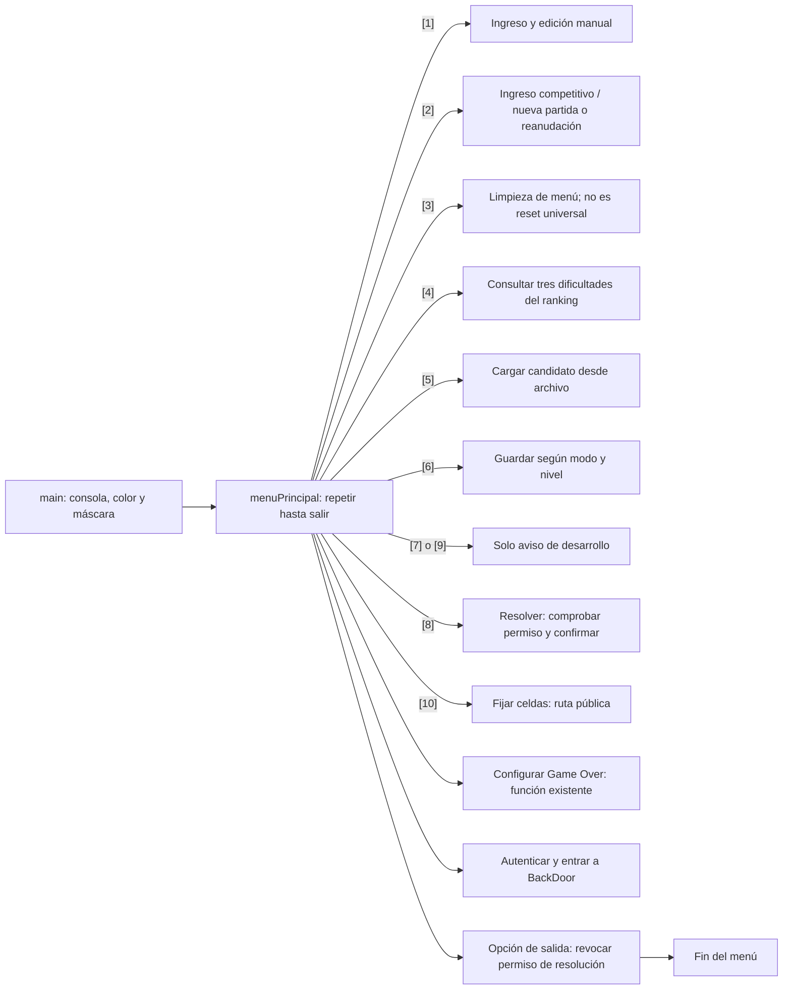

Al retornar de una operación normal se retoma el bucle del menú. El TXT no transcribe en esta sección todos los literales ni los números de las opciones de configuración, acceso administrativo y salida; no se les asigna uno. BackDoor `[100]` autorizado finaliza el proceso, según FL-11. No hay carga automática al iniciar.

### FL-02. Ingreso manual y sus retornos

COMPROBADO ESTÁTICAMENTE; alcance: [H §7.2, L1063–L1069](../informes/INFORME_ARQUITECTURA_SODOKU.txt#L1063-L1069); [H §3, L180–L195](../informes/INFORME_ARQUITECTURA_SODOKU.txt#L180-L195).

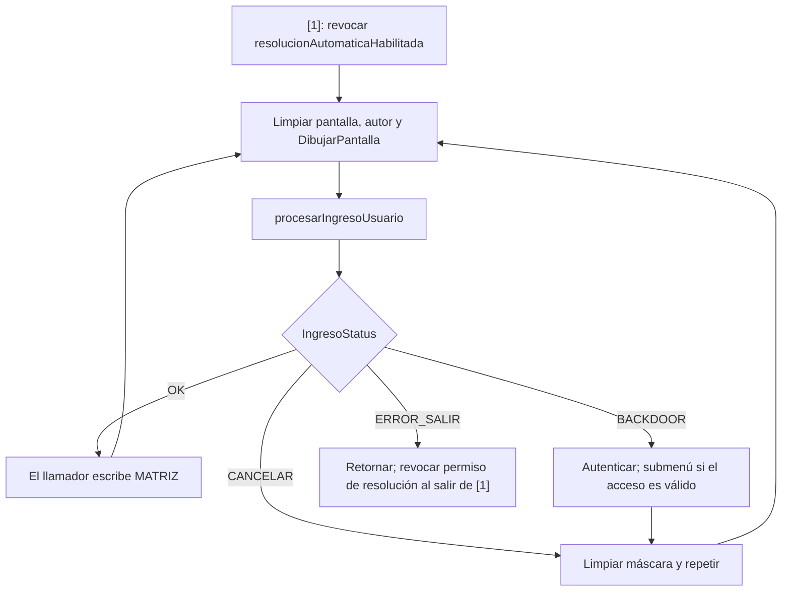

Este contexto no cambia por sí mismo `modoCompetitivo` a `false`, no comprueba victoria y no registra ranking. `CANCELAR` puede llegar después de borrar una celda o de incrementar fallos por un error lógico; no significa siempre ausencia de cambios ([H §7.5, L1097–L1110](../informes/INFORME_ARQUITECTURA_SODOKU.txt#L1097-L1110)).

### FL-03. Entrada a [2], tablero completo y reanudación

COMPROBADO ESTÁTICAMENTE; alcance: [H §7.3, L1071–L1083](../informes/INFORME_ARQUITECTURA_SODOKU.txt#L1071-L1083); [H §11, L1377–L1382](../informes/INFORME_ARQUITECTURA_SODOKU.txt#L1377-L1382).

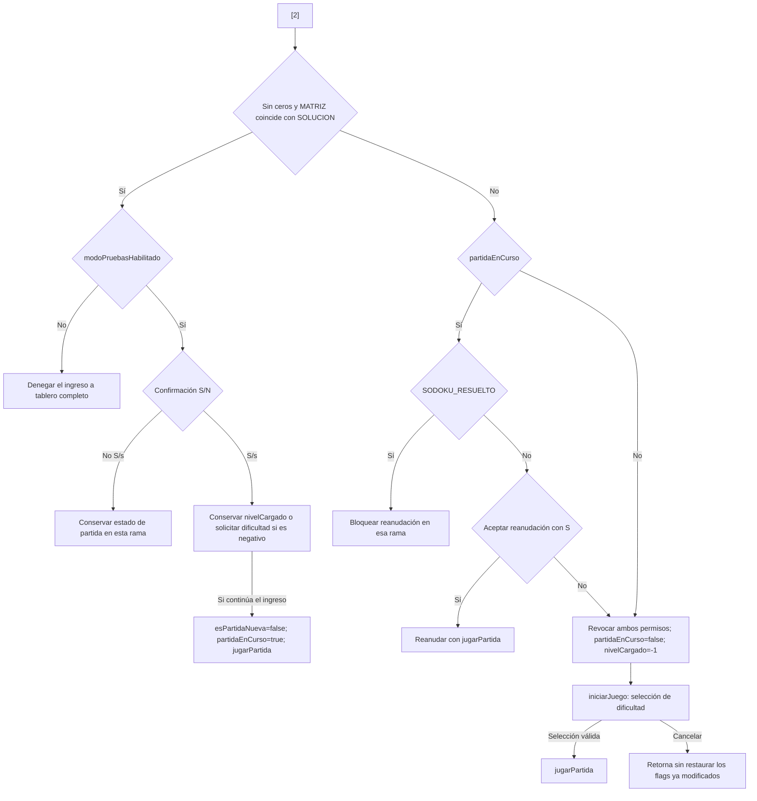

La vista de tablero completo representa la continuación descrita por el TXT; no reconstruye todos los efectos de una cancelación dentro del selector de esa rama. No se añade victoria al entrar: la comparación de victoria ocurre después de una jugada `OK`. La cancelación desde `iniciarJuego()` puede dejar el tablero anterior con nivel `-1` y permisos revocados: ARQ-02 sigue pendiente.

### FL-04. Preparación competitiva y doble generación registrada

COMPROBADO ESTÁTICAMENTE; alcance: [H §7.4, L1085–L1095](../informes/INFORME_ARQUITECTURA_SODOKU.txt#L1085-L1095); [I §3–4, L130–L174](../informes/INFORME_ACTUALIZACION_ARQUITECTURA_5c48cd4.txt#L130-L174).

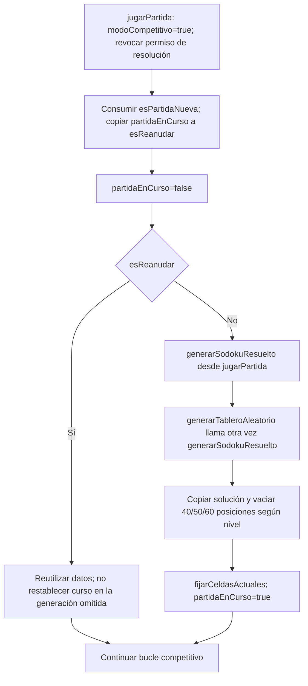

La generación duplicada está registrada; no se simplifica a una llamada. Vaciar posiciones no demuestra unicidad de solución. La ruta reanudada puede seguir con `partidaEnCurso=false` (ARQ-01), aunque esté dentro del bucle de juego.

### FL-05. Bucle competitivo, Game Over y victoria

COMPROBADO ESTÁTICAMENTE; alcance: [H §7.5–7.6, L1097–L1122](../informes/INFORME_ARQUITECTURA_SODOKU.txt#L1097-L1122).

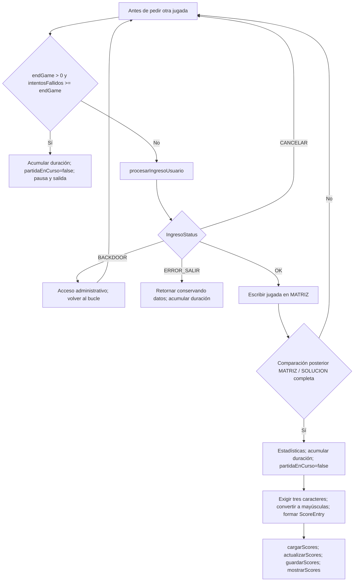

Las ramas de salida, cancelación y BackDoor evitan el chequeo posterior a `OK`. Game Over conserva tablero y contador. La victoria de esta ruta no asigna `SODOKU_RESUELTO=true`. Los llamadores revocan el permiso de resolución al regresar del juego. La corrección de las horas y de los fallos de persistencia sigue pendiente.

### FL-06. Etapas y resultados de validación de una jugada

COMPROBADO ESTÁTICAMENTE; alcance: [H §7.5, L1097–L1110](../informes/INFORME_ARQUITECTURA_SODOKU.txt#L1097-L1110); [H §12.5, L1541–L1544](../informes/INFORME_ARQUITECTURA_SODOKU.txt#L1541-L1544).

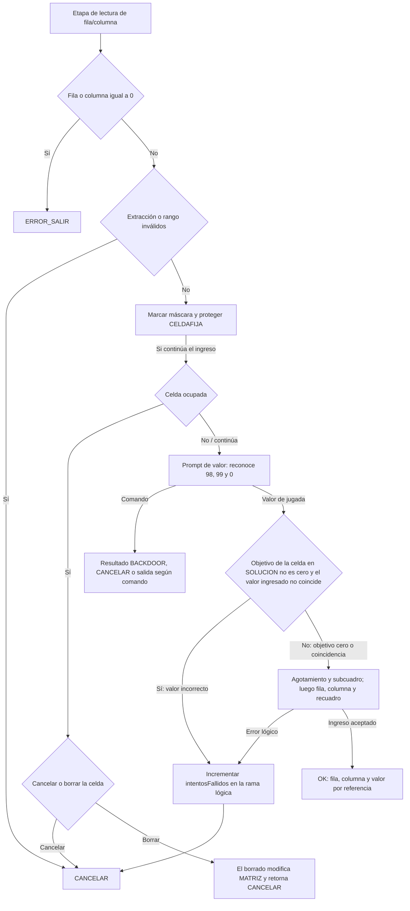

Es una vista de etapas, no una afirmación de que un rechazo de celda fija continúe hacia la lectura de valor. El TXT no detalla aquí todas las ramas de esa protección: la flecha está condicionada a que el ingreso continúe. Los códigos del prompt de valor no se trasladan a fila/columna. El llamador escribe la jugada tras `OK`; el borrado es una mutación previa y distinta. No se equiparan los invariantes de una partida con validación de formato.

### FL-07. Guardado de una partida

COMPROBADO ESTÁTICAMENTE; alcance: [H §7.7, L1124–L1131](../informes/INFORME_ARQUITECTURA_SODOKU.txt#L1124-L1131); [H §8, L1201–L1228](../informes/INFORME_ARQUITECTURA_SODOKU.txt#L1201-L1228).

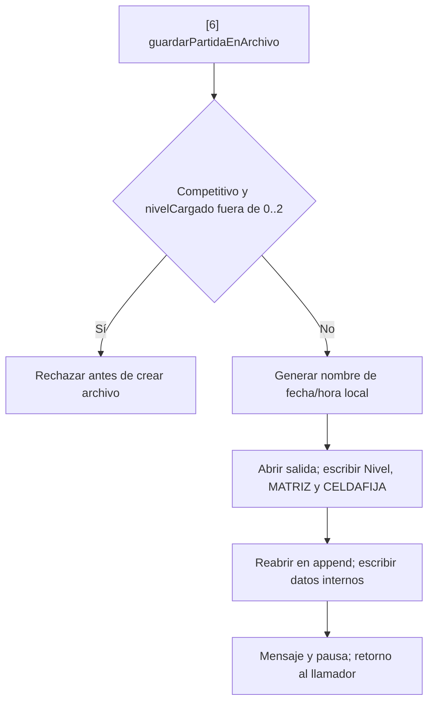

El nombre sigue `YYYYMMDD-HHMMSS.txt`, relativo al directorio de trabajo. Se guarda `Nivel:0` en libre y `nivel+1` en competitivo. El bloque contiene `SOLUCION`, `INTENTOS`, `VICTORIA` derivada de `SODOKU_RESUELTO`, `INICIO` tomado al guardar y `DURACION_S:0`. No serializa los dos permisos administrativos. El grafo muestra la secuencia nominal; no atribuye atomicidad ni propagación de todos los fallos de E/S a los helpers `void` (ARQ-05/16).

### FL-08. Carga validada antes de aplicar el candidato

COMPROBADO ESTÁTICAMENTE; alcance: [H §7.8, L1133–L1150](../informes/INFORME_ARQUITECTURA_SODOKU.txt#L1133-L1150); [H §8.2, L1226–L1228](../informes/INFORME_ARQUITECTURA_SODOKU.txt#L1226-L1228); [H §11, L1402–L1410](../informes/INFORME_ARQUITECTURA_SODOKU.txt#L1402-L1410).

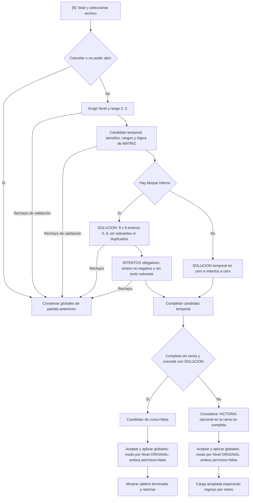

La comparación de completitud y la lectura del campo opcional se preparan sobre el candidato antes de aplicar globales. La carga no inicia `jugarPartida()`. La compatibilidad antigua exige cabecera `Nivel` y matrices requeridas; no admite por ese motivo cualquier archivo histórico de 18 líneas. El rechazo preserva globales de partida, con efectos posibles sobre `cin` y mensajes. Persisten los límites de sobrantes de `MATRIZ`/`CELDAFIJA`, el consumo parcial de `Nivel` y la coherencia entre matrices señalados por ARQ-07.

### FL-09. Resolución automática y sus dos confirmaciones

COMPROBADO ESTÁTICAMENTE; alcance: [H §7.9, L1152–L1164](../informes/INFORME_ARQUITECTURA_SODOKU.txt#L1152-L1164); [H §9, L1316–L1317](../informes/INFORME_ARQUITECTURA_SODOKU.txt#L1316-L1317).

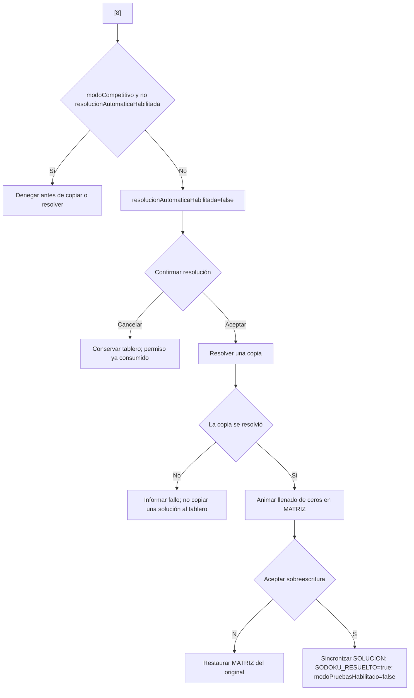

El permiso administrativo de resolución es de un intento y se consume antes de confirmar. Resolver no cambia `modoCompetitivo`, no recalcula dificultad y no registra score. La precondición del resolvedor sigue pendiente según ARQ-08; no se incorpora una validación inicial que el código no realiza.

### FL-10. Consulta y escritura de rankings

COMPROBADO ESTÁTICAMENTE; alcance: [H §7.10, L1166–L1177](../informes/INFORME_ARQUITECTURA_SODOKU.txt#L1166-L1177); [H §8.3, L1230–L1237](../informes/INFORME_ARQUITECTURA_SODOKU.txt#L1230-L1237).

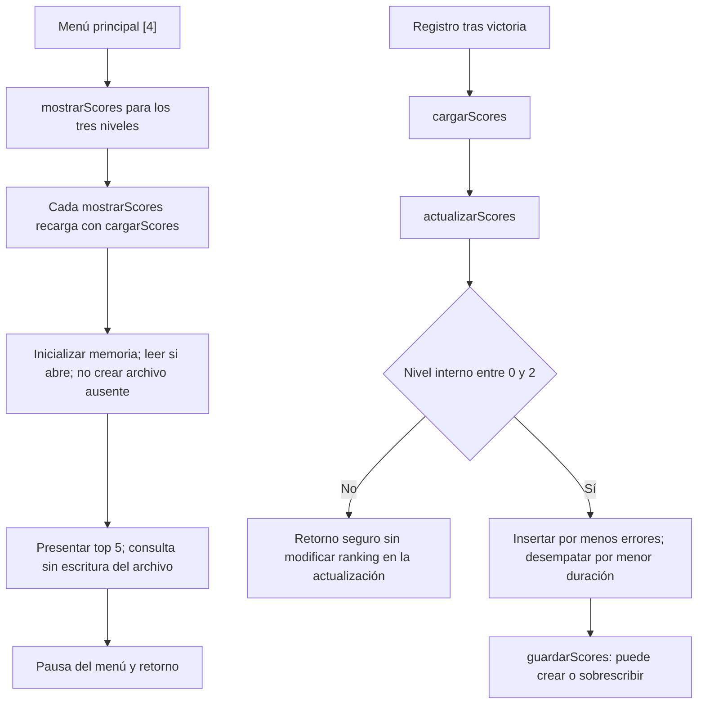

Las dos rutas son contextos separados; no se afirma que la consulta llame a `guardarScores()`. La lectura puede modificar `scores` en memoria. La guardia de nivel pertenece a `actualizarScores()`; `mostrarScores()` no dispone de guardia propia aunque los llamadores normales usan 0/1/2. El retorno seguro de la actualización no impide por sí solo que un llamador continúe con sus siguientes operaciones.

### FL-11. Acceso administrativo, despacho y retorno

COMPROBADO ESTÁTICAMENTE; alcance: [H §7.11, L1179–L1187](../informes/INFORME_ARQUITECTURA_SODOKU.txt#L1179-L1187); [H §10, L1340–L1355](../informes/INFORME_ARQUITECTURA_SODOKU.txt#L1340-L1355).

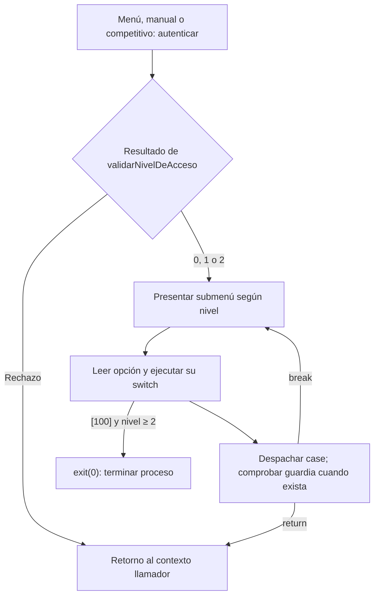

Ocultar una opción no evita que llegue a su `case`. El nivel se pasa como parámetro; no hay un rol global de sesión reutilizado automáticamente. Los retornos no se normalizan como vuelta al menú principal: dependen del llamador. No se dibuja un segundo factor efectivo que los informes no verifican.

### FL-12. Protecciones de [15], [20] y excepción [18]

COMPROBADO ESTÁTICAMENTE; alcance: [H §10, L1340–L1361](../informes/INFORME_ARQUITECTURA_SODOKU.txt#L1340-L1361); [H §9, L1295–L1299](../informes/INFORME_ARQUITECTURA_SODOKU.txt#L1295-L1299); [H §7.11–7.12, L1183–L1197](../informes/INFORME_ARQUITECTURA_SODOKU.txt#L1183-L1197).

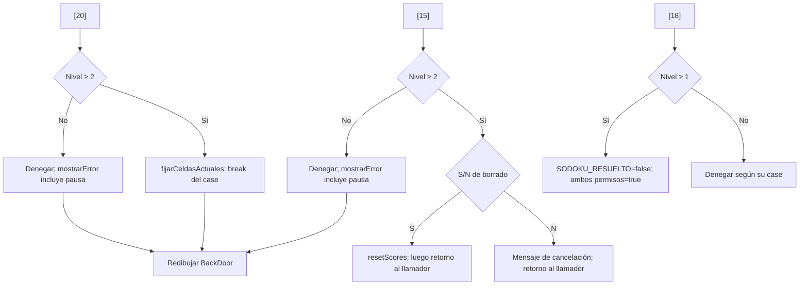

`[15]` solo llama a `resetScores()` con confirmación `S`; el TXT no certifica aquí todas las respuestas malformadas. `[20]` regresa al submenú mediante `break`. Se conserva la retirada de las tres pausas redundantes en `[15]/[20]`, sin retiradas adicionales ni un número de Enter garantizado. `[16]` exporta sin guardia local, `[17]` exige nivel ≥1 aunque no se anuncia a todos esos niveles y `[14]/[19]` no tienen implementación; son límites documentados, no correcciones propuestas ([H §10, L1340–L1368](../informes/INFORME_ARQUITECTURA_SODOKU.txt#L1340-L1368); [H §11, L1423–L1446](../informes/INFORME_ARQUITECTURA_SODOKU.txt#L1423-L1446)).

Actualización local A+B de `[18]` sobre `main` `5f82994`: el menú y los mensajes describen la habilitación de permisos administrativos de pruebas, sin afirmar que se haya iniciado `[2]` o ejecutado `[8]`. Se mantienen `nivelAcceso >= 1` y las asignaciones `SODOKU_RESUELTO=false`, `modoPruebasHabilitado=true` y `resolucionAutomaticaHabilitada=true` ([informe incremental A+B, §3, L38–L56](../informes/INFORME_INCREMENTAL_BACKDOOR_18_AB_20261126.txt#L38-L56)).

En la rama autorizada, `resetColor()` va seguido de `MSGPAUSA()`; en la denegada, `mostrarError()` incluye su pausa y no hay otra llamada común posterior. El `break` conserva el redibujado del submenú. Es una llamada a pausa por rama, sin garantizar un único Enter ni explicar por sí sola dos avisos observados en una ejecución permitida ([§5, L82–L96](../informes/INFORME_INCREMENTAL_BACKDOOR_18_AB_20261126.txt#L82-L96)). ARQ-14 y la incidencia independiente conservan su estado pendiente. El párrafo histórico anterior, incluida la referencia a `[17]`, permanece sin cambios.

## Registro de los 19 pendientes conservados

Todos los registros siguientes permanecen **PENDIENTES**. Que un aspecto esté comprobado estáticamente no cierra su observación ni demuestra su impacto en ejecución. Se conservan las 18 observaciones heredadas (13 P2 y 5 P3) y una incidencia independiente; no se crean issues ni se considera duplicada la incidencia nueva ([I §7–8, L279–L322](../informes/INFORME_ACTUALIZACION_ARQUITECTURA_5c48cd4.txt#L279-L322)).

| Registro | Prioridad heredada | Observación o incidencia | Evidencia |
| --- | --- | --- | --- |
| ARQ-01 · PENDIENTE | P2 | Reanudación con bandera no uniforme. | [H §11, L1372–L1376](../informes/INFORME_ARQUITECTURA_SODOKU.txt#L1372-L1376) |
| ARQ-02 · PENDIENTE | P2 | Cancelar dificultad no conserva todos los flags. | [H §11, L1377–L1382](../informes/INFORME_ARQUITECTURA_SODOKU.txt#L1377-L1382) |
| ARQ-03 · PENDIENTE | P2 | "Resuelto" no tiene un indicador único. | [H §11, L1383–L1386](../informes/INFORME_ARQUITECTURA_SODOKU.txt#L1383-L1386) |
| ARQ-04 · PENDIENTE | P2 | Variantes de limpieza conservan datos distintos. | [H §11, L1387–L1391](../informes/INFORME_ARQUITECTURA_SODOKU.txt#L1387-L1391) |
| ARQ-05 · PENDIENTE | P2 | Persistencia parcial del tiempo y estadísticas. | [H §11, L1392–L1396](../informes/INFORME_ARQUITECTURA_SODOKU.txt#L1392-L1396) |
| ARQ-06 · PENDIENTE | P2 | Punteros de localtime. | [H §11, L1397–L1401](../informes/INFORME_ARQUITECTURA_SODOKU.txt#L1397-L1401) |
| ARQ-07 · PENDIENTE | P2 | Formato y coherencia no uniformes. | [H §11, L1402–L1410](../informes/INFORME_ARQUITECTURA_SODOKU.txt#L1402-L1410) |
| ARQ-08 · PENDIENTE | P2 | Validadores y resolvedor no son sanitizadores. | [H §11, L1411–L1417](../informes/INFORME_ARQUITECTURA_SODOKU.txt#L1411-L1417) |
| ARQ-09 · PENDIENTE | P2 | Unicidad no garantizada. | [H §11, L1418–L1422](../informes/INFORME_ARQUITECTURA_SODOKU.txt#L1418-L1422) |
| ARQ-10 · PENDIENTE | P2 | Discrepancia de permiso de exportación. | [H §11, L1423–L1425](../informes/INFORME_ARQUITECTURA_SODOKU.txt#L1423-L1425) |
| ARQ-11 · PENDIENTE | P2 | Segundo factor anunciado sin verificación adicional. | [H §11, L1426–L1428](../informes/INFORME_ARQUITECTURA_SODOKU.txt#L1426-L1428) |
| ARQ-12 · PENDIENTE | P2 | Fijación pública y administrativa. | [H §11, L1429–L1433](../informes/INFORME_ARQUITECTURA_SODOKU.txt#L1429-L1433) |
| ARQ-13 · PENDIENTE | P3 | Opciones parciales y etiquetas. | [H §11, L1434–L1439](../informes/INFORME_ARQUITECTURA_SODOKU.txt#L1434-L1439) |
| ARQ-14 · PENDIENTE | P3 | Contratos de pausas aún mixtos. | [H §11, L1440–L1446](../informes/INFORME_ARQUITECTURA_SODOKU.txt#L1440-L1446) |
| ARQ-15 · PENDIENTE | P3 | Entrada y formato de iniciales. | [H §11, L1447–L1453](../informes/INFORME_ARQUITECTURA_SODOKU.txt#L1447-L1453) |
| ARQ-16 · PENDIENTE | P2 | Errores de persistencia. | [H §11, L1454–L1459](../informes/INFORME_ARQUITECTURA_SODOKU.txt#L1454-L1459) |
| ARQ-17 · PENDIENTE | P3 | Cabeceras y convenciones. | [H §11, L1460–L1465](../informes/INFORME_ARQUITECTURA_SODOKU.txt#L1460-L1465) |
| ARQ-18 · PENDIENTE | P3 | Documentación y metadatos desactualizados. | [H §11, L1466–L1477](../informes/INFORME_ARQUITECTURA_SODOKU.txt#L1466-L1477) |
| INC-5C48CD4-01 · PENDIENTE | Por determinar | Doble salida reportada al ingresar desde libre a BackDoor nivel 1 y elegir una opción oculta; causa y relación con ARQ-14 por verificar. | [I §8, L298–L322](../informes/INFORME_ACTUALIZACION_ARQUITECTURA_5c48cd4.txt#L298-L322) |

La incidencia nueva no tiene caso, causa o plataforma confirmados por el incremental. No se dibuja una doble salida como comportamiento verificado ni se asocia a `[15]` o `[20]` por inferencia.

## Pruebas mínimas propuestas, no ejecutadas

- Nueva partida, salida y dos reanudaciones consecutivas: observar `partidaEnCurso`, nivel y datos (ARQ-01).
- Cancelar dificultad después de un tablero existente: contrastar flags revocados y rechazo de guardado con nivel inválido (ARQ-02).
- Cargar candidatos parciales, completos, antiguos compatibles y malformados; observar directamente globales antes y después del rechazo.
- `[8]` libre/competitivo con permiso y sin permiso, cancelación inicial y final; comprobar consumo y restauración por separado.
- Ingreso a tablero completo con y sin permiso de pruebas, `N/S` y jugada posterior; no declarar victoria por el mensaje de ingreso.
- Consulta sin archivo de scores y operación administrativa por nivel, en copias aisladas. La incidencia nueva necesita identificar su opción y secuencia antes de relacionarla con ARQ-14.

Estas propuestas derivan de [H §14, L1621–L1652](../informes/INFORME_ARQUITECTURA_SODOKU.txt#L1621-L1652) y [I §8, L298–L322](../informes/INFORME_ACTUALIZACION_ARQUITECTURA_5c48cd4.txt#L298-L322); no autorizan ejecución en esta tarea.

## Verificación de esta entrega

Se comprobaron los enlaces y la trazabilidad a ambos TXT; las vistas se contrastaron con sus condiciones citadas. Los retornos o condiciones que el informe no detalla no se presentan como comprobados.

**Mermaid 11.12.1: sintaxis y renderizado SVG validados localmente en Chromium para los 12 diagramas de este documento.**

No se compila ni se ejecuta el juego o un ejecutable de prueba. No se modifican los TXT, los documentos existentes, el código, las partidas ni los rankings. La Fase C fue revisada y aprobada; su publicación en `docs/diagramas-sodoku` está autorizada.
