# Funciones y llamadas de Sodoku C++

Estado: Fase B aprobada

- Versión declarada: **0.9.4**.
- Commit del informe base: **`d9cc5c6904db2f79930b9d5757a04766cd67502d`** (`d9cc5c6`).
- Fuente técnica base: [INFORME_ARQUITECTURA_SODOKU.txt](../informes/INFORME_ARQUITECTURA_SODOKU.txt), fechado **19/11/2026**; metadatos en [L1–L8](../informes/INFORME_ARQUITECTURA_SODOKU.txt#L1-L8).
- Código actualizado contrastado: **`5c48cd4889ee3c94813ffea99269ae95ff6b80ee`**.
- Evidencia incremental del **24/11/2026**: [§0, L7–L27](../informes/INFORME_ACTUALIZACION_ARQUITECTURA_5c48cd4.txt#L7-L27).
- Estado de esta actualización: **aprobada para publicación en `docs/diagramas-sodoku`**.
- Alcance: inventario y llamadas del TXT base, complementados con el contraste estático de `5c48cd4` documentado en el informe incremental. Las firmas y las relaciones se conservan; las ubicaciones de implementación de las tablas corresponden al código actualizado. La revisión local A+B de `[18]` sobre `main` `5f82994` se documenta en el [informe incremental del 26/11/2026, §1–2, L5–L36](../informes/INFORME_INCREMENTAL_BACKDOOR_18_AB_20261126.txt#L5-L36); las tablas históricas permanecen intactas.

## 1. Cómo leer el inventario y los diagramas

Los IDs **F01–F50** conservan la numeración de las fichas de la sección 3 del TXT ([L141–L548](../informes/INFORME_ARQUITECTURA_SODOKU.txt#L141-L548)). Las firmas se transcriben completas, incluidos tipos, referencias, `const`, dimensiones y capitalización. Se conservan `string` y `vector<string>` cuando así aparecen en el informe; no se propone modificar sus firmas.

**Clasificación documental:** P identifica la entrada del programa, los menús y la coordinación de modos de juego; A identifica servicios auxiliares de ingreso, cálculo, validación, presentación o persistencia. La clasificación se basa en las responsabilidades descritas en las fichas, no establece permisos ni visibilidad C++.

En los diagramas:

- Los nodos azules son funciones P del módulo examinado; los blancos son auxiliares A del mismo módulo.
- Los nodos grises identifican destinos de otros módulos y muestran su archivo de implementación. Su rol P/A se consulta en el inventario del módulo correspondiente.
- Los nodos amarillos son las auxiliares sin llamada entrante propia registrada en el informe.
- Una flecha continua es una llamada dentro del mismo módulo; una flecha discontinua es una llamada entre módulos. **Ambas son relaciones verificadas estáticamente**, no hipótesis.
- Cada etiqueta **Lnnn** remite a esa línea exacta del TXT base, que enumera los sitios de llamada en el código. Los enlaces junto a cada diagrama cubren las fichas de sus llamadoras.
- Un par llamadora→llamada se dibuja una vez, aunque tenga varios sitios en el código. Los nodos pueden repetirse entre vistas; siguen siendo las mismas 50 funciones.
- Cada arista se ubica en el módulo de su llamadora. Las entradas procedentes de otros módulos se ven en sus respectivos diagramas; la ausencia de una flecha en una vista parcial no implica ausencia en el grafo completo.
- Las flechas no indican orden temporal ni certifican la ejecución de todos los caminos. STL, sistema, inicialización global y acceso a datos quedan fuera del grafo de funciones propias ([L143–L148](../informes/INFORME_ARQUITECTURA_SODOKU.txt#L143-L148); §5.5, [L956–L964](../informes/INFORME_ARQUITECTURA_SODOKU.txt#L956-L964)).

El módulo principal se divide por responsabilidad y separa mensajes/consola de las operaciones de juego. En `archivos.cpp`, las operaciones de persistencia y las utilidades de consola se muestran por separado. No se omiten esas llamadas del conjunto de diagramas.

## 2. Módulo `Sodoku.cpp` — 21 funciones

| ID y rol | Firma completa | Implementación en `5c48cd4` | Declaración(es) compatible(s) | Ficha del TXT base |
| --- | --- | --- | --- | --- |
| F01 · A | `void limpiarTablero()` | `src/Sodoku.cpp:67–72` | `src/Sodoku.h:40` | §3, [L149–L153](../informes/INFORME_ARQUITECTURA_SODOKU.txt#L149-L153) |
| F02 · A | `void generarMascara(int fila, int columna, char mascara[TAM][TAM])` | `src/Sodoku.cpp:74–81` | `src/Sodoku.h:41` | §3, [L154–L159](../informes/INFORME_ARQUITECTURA_SODOKU.txt#L154-L159) |
| F03 · A | `void mostrarMatriz(int matriz[TAM][TAM], std::string titulo)` | `src/Sodoku.cpp:83–106` | `src/Sodoku.h:60` | §3, [L160–L166](../informes/INFORME_ARQUITECTURA_SODOKU.txt#L160-L166) |
| F04 · A | `void generarMascaraCompletaPausa(char CARACTERPAUSA)` | `src/Sodoku.cpp:108–112` | `src/Sodoku.h:42` | §3, [L167–L171](../informes/INFORME_ARQUITECTURA_SODOKU.txt#L167-L171) |
| F05 · A | `void DibujarPantalla()` | `src/Sodoku.cpp:114–145` | `src/Sodoku.h:44` | §3, [L172–L179](../informes/INFORME_ARQUITECTURA_SODOKU.txt#L172-L179) |
| F06 · P | `void modoIngresoManual()` | `src/Sodoku.cpp:149–190` | `src/Sodoku.h:45` | §3, [L180–L195](../informes/INFORME_ARQUITECTURA_SODOKU.txt#L180-L195) |
| F07 · A | `int seleccionarDificultad()` | `src/Sodoku.cpp:192–232` | `src/Sodoku.h:46` | §3, [L196–L203](../informes/INFORME_ARQUITECTURA_SODOKU.txt#L196-L203) |
| F08 · P | `void iniciarJuego()` | `src/Sodoku.cpp:235–299` | `src/Sodoku.h:47` | §3, [L204–L215](../informes/INFORME_ARQUITECTURA_SODOKU.txt#L204-L215) |
| F09 · P | `void jugarPartida(int nivel)` | `src/Sodoku.cpp:303–503` | `src/Sodoku.h:48` | §3, [L216–L239](../informes/INFORME_ARQUITECTURA_SODOKU.txt#L216-L239) |
| F10 · A | `bool validaHorizontal(int matriz[TAM][TAM], int fila, int valor)` | `src/Sodoku.cpp:515–521` | `src/Sodoku.h:49` | §3, [L240–L244](../informes/INFORME_ARQUITECTURA_SODOKU.txt#L240-L244) |
| F11 · A | `bool validaVertical(int matriz[TAM][TAM], int columna, int valor)` | `src/Sodoku.cpp:523–529` | `src/Sodoku.h:50` | §3, [L245–L249](../informes/INFORME_ARQUITECTURA_SODOKU.txt#L245-L249) |
| F12 · A | `bool validaRecuadro(int matriz[TAM][TAM], int fila, int columna, int valor)` | `src/Sodoku.cpp:531–541` | `src/Sodoku.h:51` | §3, [L250–L254](../informes/INFORME_ARQUITECTURA_SODOKU.txt#L250-L254) |
| F13 · A | `void fijarCeldasActuales()` | `src/Sodoku.cpp:543–550` | `src/Sodoku.h:52` | §3, [L255–L260](../informes/INFORME_ARQUITECTURA_SODOKU.txt#L255-L260) |
| F14 · A | `bool hayCeldasFijas()` | `src/Sodoku.cpp:552–558` | `src/Sodoku.h:53` | §3, [L261–L265](../informes/INFORME_ARQUITECTURA_SODOKU.txt#L261-L265) |
| F15 · A | `bool numeroAgotadoGlobal(int numero)` | `src/Sodoku.cpp:560–572` | `src/Sodoku.h:54` | §3, [L266–L270](../informes/INFORME_ARQUITECTURA_SODOKU.txt#L266-L270) |
| F16 · A | `bool numeroPresenteEnCuadro(int fila, int columna, int numero)` | `src/Sodoku.cpp:574–586` | `src/Sodoku.h:55` | §3, [L271–L275](../informes/INFORME_ARQUITECTURA_SODOKU.txt#L271-L275) |
| F17 · A | `int cantidadRestante(int numero)` | `src/Sodoku.cpp:588–599` | `src/Sodoku.h:56` | §3, [L276–L280](../informes/INFORME_ARQUITECTURA_SODOKU.txt#L276-L280) |
| F18 · P | `void menuPrincipal()` | `src/Sodoku.cpp:602–877` | `src/Sodoku.h:57` | §3, [L281–L307](../informes/INFORME_ARQUITECTURA_SODOKU.txt#L281-L307) |
| F19 · A | `IngresoStatus procesarIngresoUsuario(int& fila, int& columna, int& valor)` | `src/Sodoku.cpp:879–1023` | `src/Sodoku.h:62` | §3, [L308–L327](../informes/INFORME_ARQUITECTURA_SODOKU.txt#L308-L327) |
| F20 · A | `void configurarGameOver()` | `src/Sodoku.cpp:1027–1072` | `src/Sodoku.h:68` | §3, [L328–L338](../informes/INFORME_ARQUITECTURA_SODOKU.txt#L328-L338) |
| F21 · P · entrada | `int main()` | `src/Sodoku.cpp:1077–1083` | `src/Sodoku.h:59` | §3, [L339–L347](../informes/INFORME_ARQUITECTURA_SODOKU.txt#L339-L347) |

### S1. Entrada y menú: operaciones

19 nodos representados; 19 pares de llamadas. Fichas de las llamadoras o funciones aisladas: F18 ([L281–L307](../informes/INFORME_ARQUITECTURA_SODOKU.txt#L281-L307)), F21 ([L339–L347](../informes/INFORME_ARQUITECTURA_SODOKU.txt#L339-L347)).

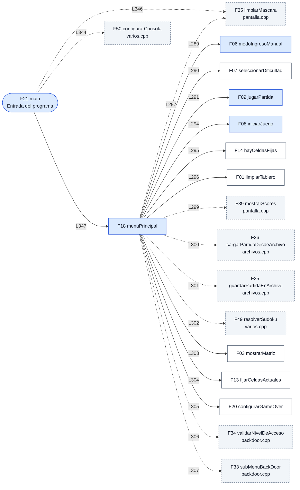

### S2. Modos de ingreso e inicio de partida: operaciones

17 nodos representados; 21 pares de llamadas. Fichas de las llamadoras o funciones aisladas: F06 ([L180–L195](../informes/INFORME_ARQUITECTURA_SODOKU.txt#L180-L195)), F08 ([L204–L215](../informes/INFORME_ARQUITECTURA_SODOKU.txt#L204-L215)), F09 ([L216–L239](../informes/INFORME_ARQUITECTURA_SODOKU.txt#L216-L239)).

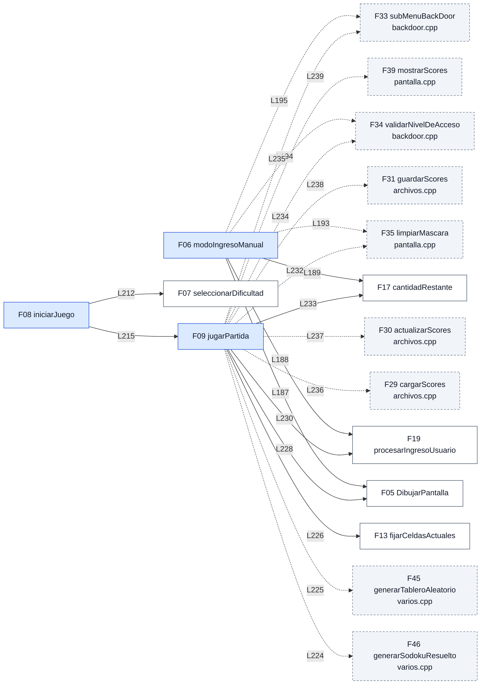

### S3. Validación, máscara y auxiliares: operaciones

13 nodos representados; 12 pares de llamadas. Fichas de las llamadoras o funciones aisladas: F02 ([L154–L159](../informes/INFORME_ARQUITECTURA_SODOKU.txt#L154-L159)), F04 ([L167–L171](../informes/INFORME_ARQUITECTURA_SODOKU.txt#L167-L171)), F05 ([L172–L179](../informes/INFORME_ARQUITECTURA_SODOKU.txt#L172-L179)), F19 ([L308–L327](../informes/INFORME_ARQUITECTURA_SODOKU.txt#L308-L327)).

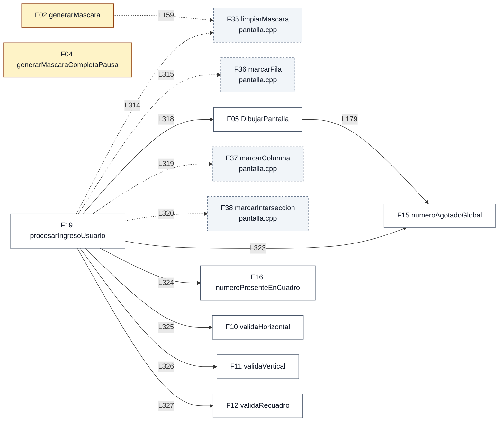

### S4. Entrada y menú: mensajes y consola

8 nodos representados; 7 pares de llamadas. Fichas de las llamadoras o funciones aisladas: F18 ([L281–L307](../informes/INFORME_ARQUITECTURA_SODOKU.txt#L281-L307)), F21 ([L339–L347](../informes/INFORME_ARQUITECTURA_SODOKU.txt#L339-L347)).

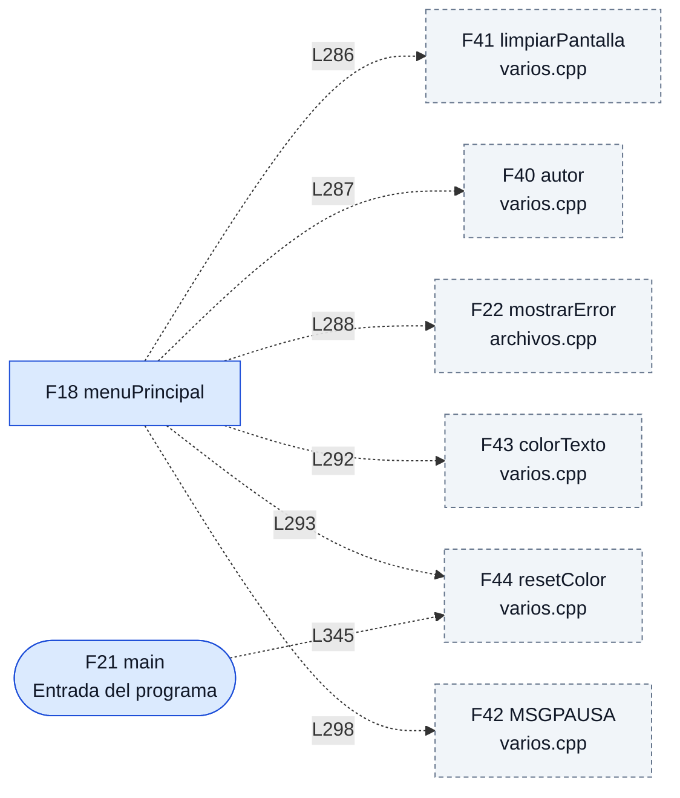

### S5. Ingreso manual e inicio: mensajes y consola

8 nodos representados; 10 pares de llamadas. Fichas de las llamadoras o funciones aisladas: F06 ([L180–L195](../informes/INFORME_ARQUITECTURA_SODOKU.txt#L180-L195)), F08 ([L204–L215](../informes/INFORME_ARQUITECTURA_SODOKU.txt#L204-L215)).

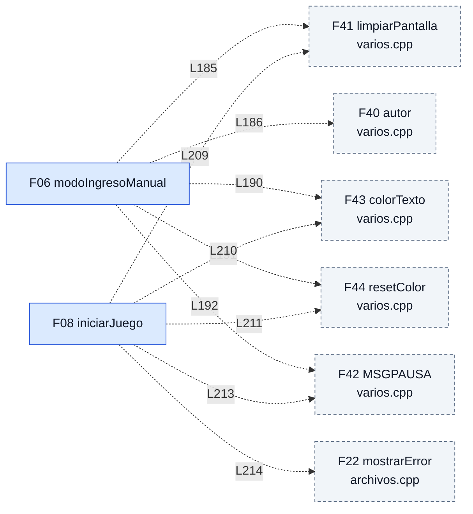

### S6. Partida competitiva: mensajes y consola

7 nodos representados; 6 pares de llamadas. Fichas de las llamadoras o funciones aisladas: F09 ([L216–L239](../informes/INFORME_ARQUITECTURA_SODOKU.txt#L216-L239)).

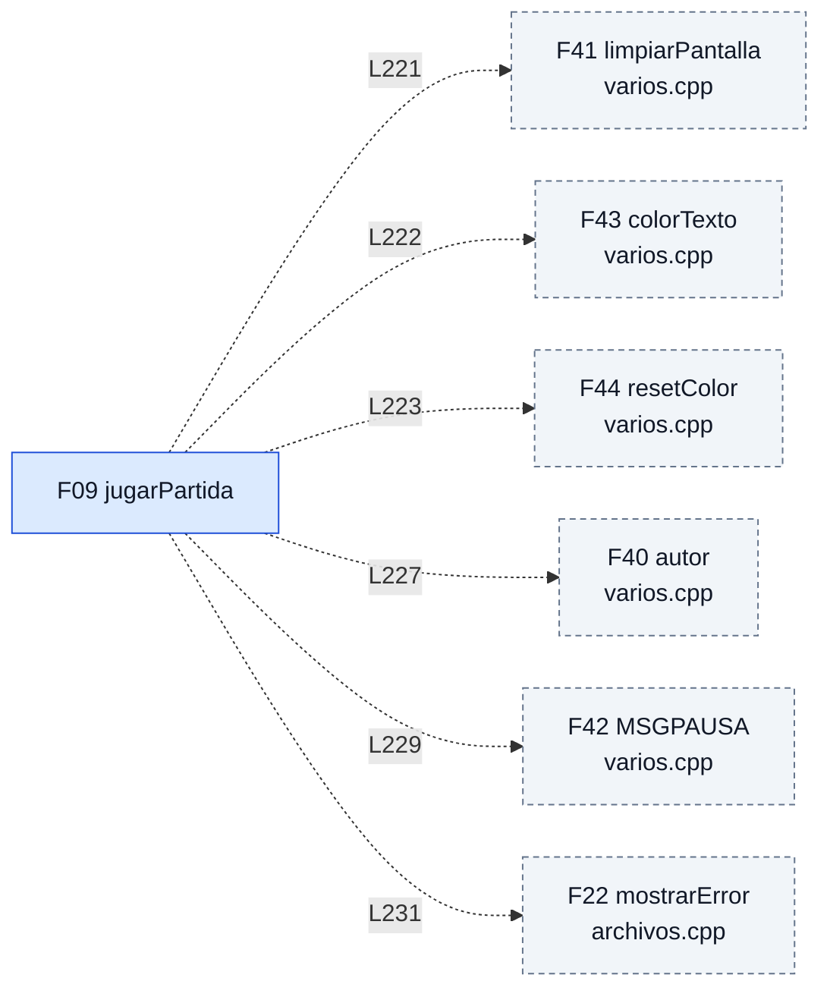

### S7. Presentación y validaciones: mensajes y consola

7 nodos representados; 8 pares de llamadas. Fichas de las llamadoras o funciones aisladas: F03 ([L160–L166](../informes/INFORME_ARQUITECTURA_SODOKU.txt#L160-L166)), F05 ([L172–L179](../informes/INFORME_ARQUITECTURA_SODOKU.txt#L172-L179)), F07 ([L196–L203](../informes/INFORME_ARQUITECTURA_SODOKU.txt#L196-L203)), F13 ([L255–L260](../informes/INFORME_ARQUITECTURA_SODOKU.txt#L255-L260)).

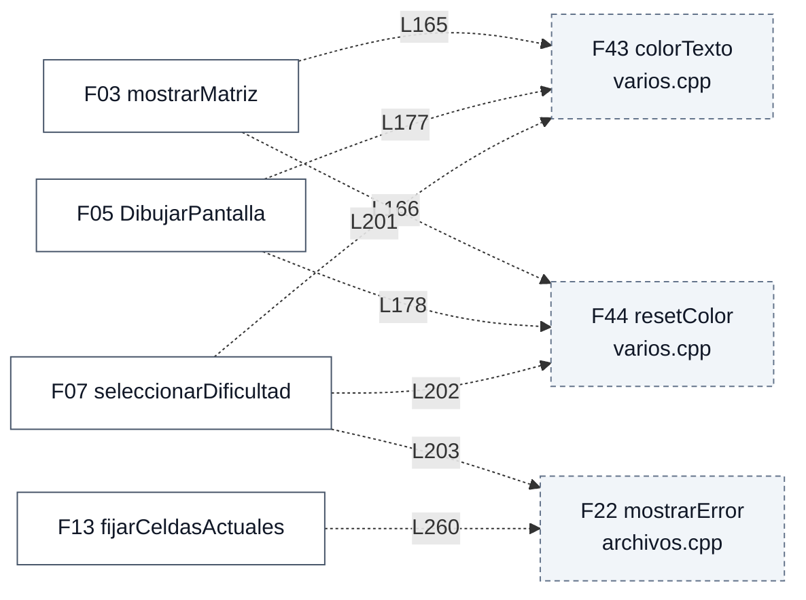

### S8. Ingreso y configuración: mensajes y consola

8 nodos representados; 11 pares de llamadas. Fichas de las llamadoras o funciones aisladas: F19 ([L308–L327](../informes/INFORME_ARQUITECTURA_SODOKU.txt#L308-L327)), F20 ([L328–L338](../informes/INFORME_ARQUITECTURA_SODOKU.txt#L328-L338)).

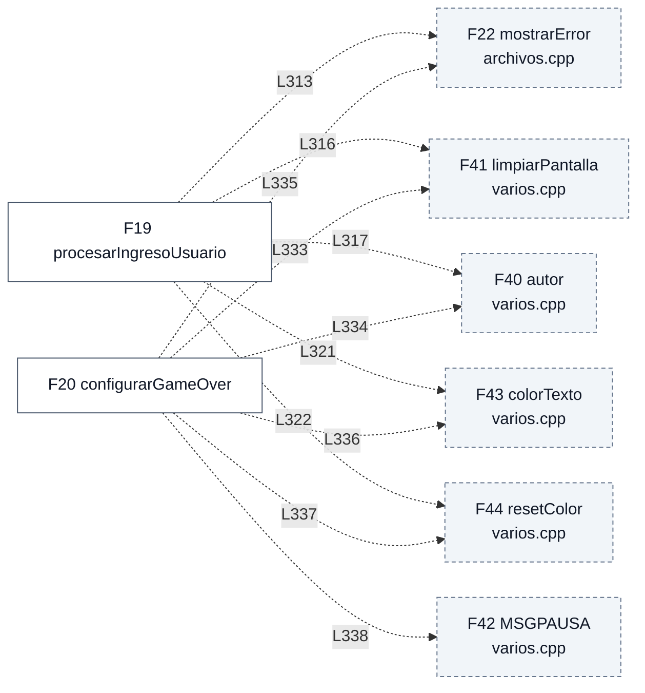

## 3. Módulo `archivos.cpp` — 11 funciones

| ID y rol | Firma completa | Implementación en `5c48cd4` | Declaración(es) compatible(s) | Ficha del TXT base |
| --- | --- | --- | --- | --- |
| F22 · A | `void mostrarError(string mensaje)` | `src/archivos.cpp:30–35` | `src/archivos.h:12` | §3, [L348–L355](../informes/INFORME_ARQUITECTURA_SODOKU.txt#L348-L355) |
| F23 · A | `string generarNombreArchivo()` | `src/archivos.cpp:37–52` | `src/archivos.h:10` | §3, [L356–L360](../informes/INFORME_ARQUITECTURA_SODOKU.txt#L356-L360) |
| F24 · A | `vector<string> listarArchivosGuardados()` | `src/archivos.cpp:55–73` | `src/archivos.h:11` | §3, [L361–L365](../informes/INFORME_ARQUITECTURA_SODOKU.txt#L361-L365) |
| F25 · A | `void guardarPartidaEnArchivo()` | `src/archivos.cpp:76–181` | `src/archivos.h:13` | §3, [L366–L375](../informes/INFORME_ARQUITECTURA_SODOKU.txt#L366-L375) |
| F26 · A | `void cargarPartidaDesdeArchivo()` | `src/archivos.cpp:184–453` | `src/archivos.h:14` | §3, [L376–L388](../informes/INFORME_ARQUITECTURA_SODOKU.txt#L376-L388) |
| F27 · A | `bool sudokuValido(int matriz[TAM][TAM])` | `src/archivos.cpp:456–502` | `src/archivos.h:15` | §3, [L389–L393](../informes/INFORME_ARQUITECTURA_SODOKU.txt#L389-L393) |
| F28 · A | `void exportarMatrizACSV()` | `src/archivos.cpp:504–535` | `src/archivos.h:16` | §3, [L394–L402](../informes/INFORME_ARQUITECTURA_SODOKU.txt#L394-L402) |
| F29 · A | `void cargarScores()` | `src/archivos.cpp:540–596` | `src/archivos.h:31` | §3, [L403–L408](../informes/INFORME_ARQUITECTURA_SODOKU.txt#L403-L408) |
| F30 · A | `void actualizarScores(const ScoreEntry& entrada)` | `src/archivos.cpp:601–619` | `src/archivos.h:32` | §3, [L409–L413](../informes/INFORME_ARQUITECTURA_SODOKU.txt#L409-L413) |
| F31 · A | `void guardarScores()` | `src/archivos.cpp:624–653` | `src/archivos.h:33` | §3, [L414–L419](../informes/INFORME_ARQUITECTURA_SODOKU.txt#L414-L419) |
| F32 · A | `void resetScores()` | `src/archivos.cpp:658–673` | `src/archivos.h:34` | §3, [L420–L425](../informes/INFORME_ARQUITECTURA_SODOKU.txt#L420-L425) |

### A1. Persistencia, validación y mensajes

13 nodos representados; 11 pares de llamadas. Fichas de las llamadoras o funciones aisladas: F25 ([L366–L375](../informes/INFORME_ARQUITECTURA_SODOKU.txt#L366-L375)), F26 ([L376–L388](../informes/INFORME_ARQUITECTURA_SODOKU.txt#L376-L388)), F28 ([L394–L402](../informes/INFORME_ARQUITECTURA_SODOKU.txt#L394-L402)), F29 ([L403–L408](../informes/INFORME_ARQUITECTURA_SODOKU.txt#L403-L408)), F31 ([L414–L419](../informes/INFORME_ARQUITECTURA_SODOKU.txt#L414-L419)), F32 ([L420–L425](../informes/INFORME_ARQUITECTURA_SODOKU.txt#L420-L425)).

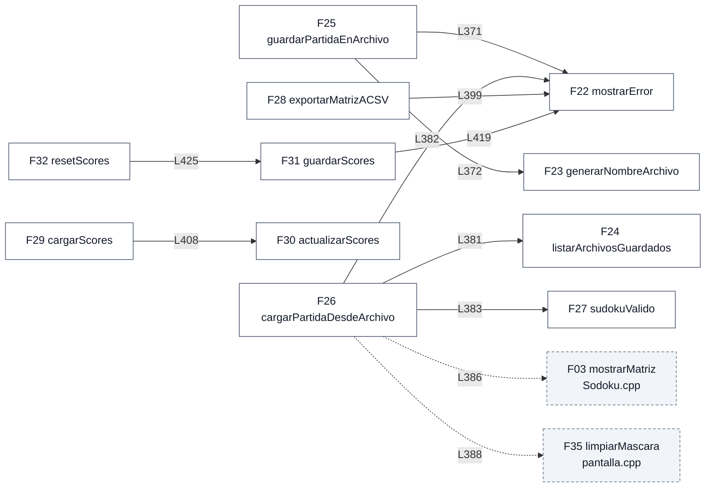

### A2. Mensajes y guardado: utilidades de consola

5 nodos representados; 6 pares de llamadas. Fichas de las llamadoras o funciones aisladas: F22 ([L348–L355](../informes/INFORME_ARQUITECTURA_SODOKU.txt#L348-L355)), F25 ([L366–L375](../informes/INFORME_ARQUITECTURA_SODOKU.txt#L366-L375)).

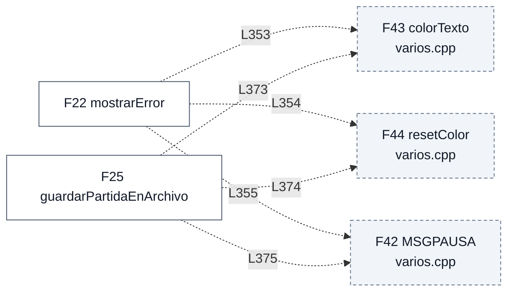

### A3. Carga y exportación: utilidades de consola

5 nodos representados; 6 pares de llamadas. Fichas de las llamadoras o funciones aisladas: F26 ([L376–L388](../informes/INFORME_ARQUITECTURA_SODOKU.txt#L376-L388)), F28 ([L394–L402](../informes/INFORME_ARQUITECTURA_SODOKU.txt#L394-L402)).

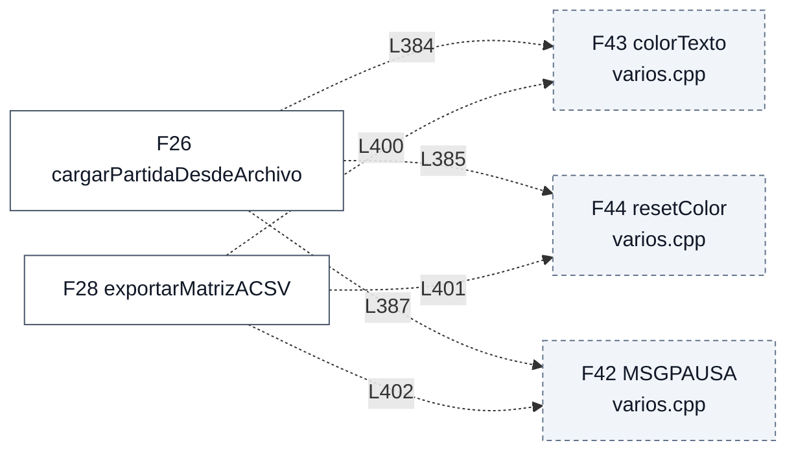

## 4. Módulo `backdoor.cpp` — 2 funciones

| ID y rol | Firma completa | Implementación en `5c48cd4` | Declaración(es) compatible(s) | Ficha del TXT base |
| --- | --- | --- | --- | --- |
| F33 · P | `void subMenuBackDoor(int nivelAcceso)` | `src/backdoor.cpp:48–634` | `src/Sodoku.h:58`; `src/backdoor.h:7` | §3, [L426–L442](../informes/INFORME_ARQUITECTURA_SODOKU.txt#L426-L442) |
| F34 · A | `int validarNivelDeAcceso()` | `src/backdoor.cpp:636–671` | `src/backdoor.h:8` | §3, [L443–L451](../informes/INFORME_ARQUITECTURA_SODOKU.txt#L443-L451) |

Actualización local de BackDoor `[18]` A+B sobre `main` `5f82994`: la llamada a `mostrarError()` pasa de `src/backdoor.cpp:613` a `614`, y la llamada a `MSGPAUSA()` de `615` a `612`, dentro de la rama autorizada y después de `resetColor()` en `611`. Las firmas, rangos de definición y pares de llamadas se conservan; las etiquetas `L433`, `L434` y `L436` siguen refiriéndose al TXT histórico. Véase [informe incremental A+B, §4, L58–L80](../informes/INFORME_INCREMENTAL_BACKDOOR_18_AB_20261126.txt#L58-L80).

El informe incremental se conserva íntegro como instantánea de A+B anterior a la actualización del comentario de `src/backdoor.cpp:603` autorizada en este cierre. Ese ajuste de comentario no modifica llamadas, rangos ni comportamiento. Esta revisión no incorpora AUD-12.

### B1. Administración y autenticación: llamadas públicas

14 nodos representados; 16 pares de llamadas. Fichas de las llamadoras o funciones aisladas: F33 ([L426–L442](../informes/INFORME_ARQUITECTURA_SODOKU.txt#L426-L442)), F34 ([L443–L451](../informes/INFORME_ARQUITECTURA_SODOKU.txt#L443-L451)).

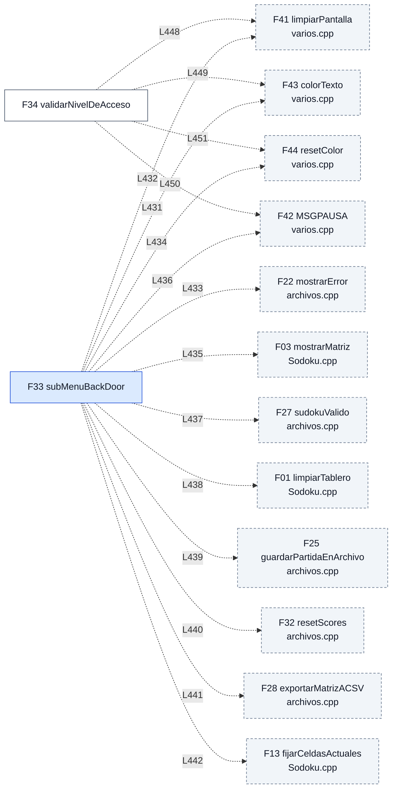

Las llamadas a `validarNivelDeAcceso()` y `subMenuBackDoor()` proceden de los modos y el menú de `Sodoku.cpp`. No se dibuja una llamada entre ambas funciones: sus fichas no la registran. Tampoco se agrega la antigua llamada de BackDoor a `mostrarScores()`, expresamente descartada por §5.4, [L945–L954](../informes/INFORME_ARQUITECTURA_SODOKU.txt#L945-L954). No se reproducen credenciales, valores de acceso ni datos de autenticación.

## 5. Módulo `pantalla.cpp` — 5 funciones

| ID y rol | Firma completa | Implementación en `5c48cd4` | Declaración(es) compatible(s) | Ficha del TXT base |
| --- | --- | --- | --- | --- |
| F35 · A | `void limpiarMascara(char mascara[TAM][TAM])` | `src/pantalla.cpp:24–28` | `src/pantalla.h:7` | §3, [L452–L456](../informes/INFORME_ARQUITECTURA_SODOKU.txt#L452-L456) |
| F36 · A | `void marcarFila(int fila)` | `src/pantalla.cpp:30–34` | `src/pantalla.h:8` | §3, [L457–L462](../informes/INFORME_ARQUITECTURA_SODOKU.txt#L457-L462) |
| F37 · A | `void marcarColumna(int columna)` | `src/pantalla.cpp:36–40` | `src/pantalla.h:9` | §3, [L463–L467](../informes/INFORME_ARQUITECTURA_SODOKU.txt#L463-L467) |
| F38 · A | `void marcarInterseccion(int fila, int columna)` | `src/pantalla.cpp:42–44` | `src/pantalla.h:10` | §3, [L468–L472](../informes/INFORME_ARQUITECTURA_SODOKU.txt#L468-L472) |
| F39 · A | `void mostrarScores(int nivel)` | `src/pantalla.cpp:49–85` | `src/pantalla.h:11` | §3, [L473–L478](../informes/INFORME_ARQUITECTURA_SODOKU.txt#L473-L478) |

### P1. Máscara y presentación de rankings

6 nodos representados; 2 pares de llamadas. Fichas de las llamadoras o funciones aisladas: F35 ([L452–L456](../informes/INFORME_ARQUITECTURA_SODOKU.txt#L452-L456)), F36 ([L457–L462](../informes/INFORME_ARQUITECTURA_SODOKU.txt#L457-L462)), F37 ([L463–L467](../informes/INFORME_ARQUITECTURA_SODOKU.txt#L463-L467)), F38 ([L468–L472](../informes/INFORME_ARQUITECTURA_SODOKU.txt#L468-L472)), F39 ([L473–L478](../informes/INFORME_ARQUITECTURA_SODOKU.txt#L473-L478)).

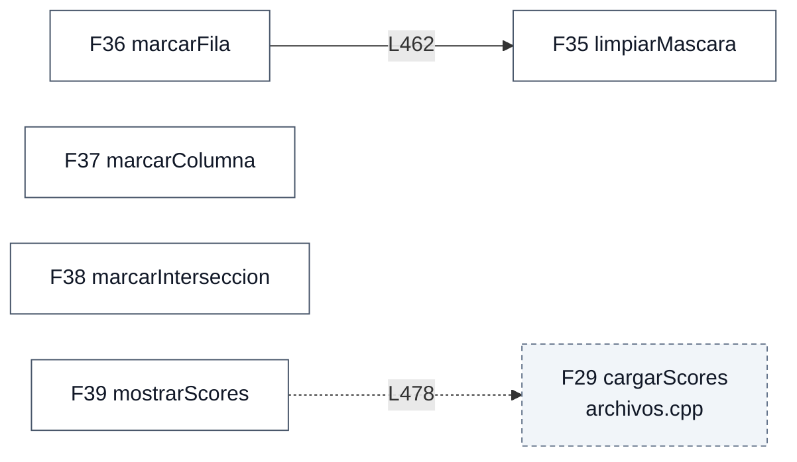

`marcarColumna()` y `marcarInterseccion()` reciben llamadas de `procesarIngresoUsuario()` en S3. `limpiarMascara()` recibe además llamadas desde otros diagramas. No son funciones sin entradas por aparecer sin conexión en alguna vista parcial.

## 6. Módulo `varios.cpp` — 11 funciones

Las once firmas y las declaraciones permanecen iguales. Los rangos actuales de las nueve implementaciones desplazadas y de las dos conservadas están documentados en [§3, L108–L147](../informes/INFORME_ACTUALIZACION_ARQUITECTURA_5c48cd4.txt#L108-L147). Las fichas enlazadas en la última columna siguen perteneciendo al TXT base histórico.

| ID y rol | Firma completa | Implementación en `5c48cd4` | Declaración(es) compatible(s) | Ficha del TXT base |
| --- | --- | --- | --- | --- |
| F40 · A | `void autor()` | `src/varios.cpp:35–78` | `src/varios.h:26` | §3, [L479–L485](../informes/INFORME_ARQUITECTURA_SODOKU.txt#L479-L485) |
| F41 · A | `void limpiarPantalla()` | `src/varios.cpp:86–102` | `src/varios.h:28` | §3, [L486–L490](../informes/INFORME_ARQUITECTURA_SODOKU.txt#L486-L490) |
| F42 · A | `void MSGPAUSA()` | `src/varios.cpp:106–111` | `src/varios.h:27` | §3, [L491–L495](../informes/INFORME_ARQUITECTURA_SODOKU.txt#L491-L495) |
| F43 · A | `void colorTexto(const std::string& color)` | `src/varios.cpp:114–131` | `src/varios.h:29` | §3, [L496–L500](../informes/INFORME_ARQUITECTURA_SODOKU.txt#L496-L500) |
| F44 · A | `void resetColor()` | `src/varios.cpp:134–136` | `src/varios.h:30` | §3, [L501–L505](../informes/INFORME_ARQUITECTURA_SODOKU.txt#L501-L505) |
| F45 · A | `void generarTableroAleatorio(int nivel)` | `src/varios.cpp:140–181` | `src/Sodoku.h:43`; `src/varios.h:33` | §3, [L506–L516](../informes/INFORME_ARQUITECTURA_SODOKU.txt#L506-L516) |
| F46 · A | `bool generarSodokuResuelto()` | `src/varios.cpp:185–193` | `src/varios.h:34` | §3, [L517–L522](../informes/INFORME_ARQUITECTURA_SODOKU.txt#L517-L522) |
| F47 · A | `void vaciarCeldas(int nivel)` | `src/varios.cpp:197–235` | `src/varios.h:37` | §3, [L523–L529](../informes/INFORME_ARQUITECTURA_SODOKU.txt#L523-L529) |
| F48 · A | `bool esSeguro(int matriz[TAM][TAM], int fila, int columna, int numero)` | `src/varios.cpp:237–257` | `src/varios.h:36` | §3, [L530–L534](../informes/INFORME_ARQUITECTURA_SODOKU.txt#L530-L534) |
| F49 · A | `bool resolverSudoku(int matriz[TAM][TAM])` | `src/varios.cpp:259–279` | `src/varios.h:35` | §3, [L535–L541](../informes/INFORME_ARQUITECTURA_SODOKU.txt#L535-L541) |
| F50 · A | `void configurarConsola()` | `src/varios.cpp:282–295` | `src/varios.h:40` | §3, [L542–L547](../informes/INFORME_ARQUITECTURA_SODOKU.txt#L542-L547) |

### V1. Generación, resolución y utilidades

12 nodos representados; 14 pares de llamadas. Fichas de las llamadoras o funciones aisladas: F40 ([L479–L485](../informes/INFORME_ARQUITECTURA_SODOKU.txt#L479-L485)), F41 ([L486–L490](../informes/INFORME_ARQUITECTURA_SODOKU.txt#L486-L490)), F42 ([L491–L495](../informes/INFORME_ARQUITECTURA_SODOKU.txt#L491-L495)), F43 ([L496–L500](../informes/INFORME_ARQUITECTURA_SODOKU.txt#L496-L500)), F44 ([L501–L505](../informes/INFORME_ARQUITECTURA_SODOKU.txt#L501-L505)), F45 ([L506–L516](../informes/INFORME_ARQUITECTURA_SODOKU.txt#L506-L516)), F46 ([L517–L522](../informes/INFORME_ARQUITECTURA_SODOKU.txt#L517-L522)), F47 ([L523–L529](../informes/INFORME_ARQUITECTURA_SODOKU.txt#L523-L529)), F48 ([L530–L534](../informes/INFORME_ARQUITECTURA_SODOKU.txt#L530-L534)), F49 ([L535–L541](../informes/INFORME_ARQUITECTURA_SODOKU.txt#L535-L541)), F50 ([L542–L547](../informes/INFORME_ARQUITECTURA_SODOKU.txt#L542-L547)).

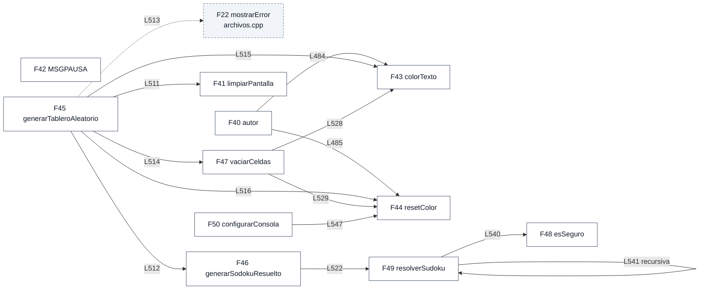

## 7. Entradas, funciones sin llamadas entrantes y recursión

| Función | Situación en el grafo propio | Evidencia exacta |
| --- | --- | --- |
| F21 `main()` | Punto de entrada del programa; no recibe llamadas de otra función propia registrada. La invocación inicial del entorno de ejecución queda fuera del grafo inspeccionado. | §3, [L339–L347](../informes/INFORME_ARQUITECTURA_SODOKU.txt#L339-L347) y revisión del inventario de llamadas §3, [L149–L547](../informes/INFORME_ARQUITECTURA_SODOKU.txt#L149-L547) |
| F02 `generarMascara(...)` | Auxiliar sin llamada entrante propia detectada; sí llama a `limpiarMascara()`. | §3, [L154–L159](../informes/INFORME_ARQUITECTURA_SODOKU.txt#L154-L159); §5.3, [L940–L943](../informes/INFORME_ARQUITECTURA_SODOKU.txt#L940-L943) |
| F04 `generarMascaraCompletaPausa(...)` | Auxiliar sin llamada entrante propia y sin llamadas salientes propias detectadas. | §3, [L167–L171](../informes/INFORME_ARQUITECTURA_SODOKU.txt#L167-L171); §5.3, [L940–L943](../informes/INFORME_ARQUITECTURA_SODOKU.txt#L940-L943) |

La lista de §5.3 destaca las dos auxiliares F02 y F04. El recuento por entradas de las fichas de §3 incluye además `main()` como caso especial de entrada. Ninguna de estas observaciones demuestra por sí sola que una API externa o una prueba ajena al alcance no pudiera llamar a una función.

**Recursión directa verificada:** F49 `resolverSudoku(int matriz[TAM][TAM])` se llama a sí misma en `src/varios.cpp:269` del código actualizado, con el candidato validado mediante F48 `esSeguro(...)`. La arista de V1 está etiquetada como recursiva (línea del TXT [L539–L541](../informes/INFORME_ARQUITECTURA_SODOKU.txt#L539-L541); resumen §5.3, [L932–L938](../informes/INFORME_ARQUITECTURA_SODOKU.txt#L932-L938)). La correspondencia del sitio histórico 267 al actual 269 se documenta en [§4, L149–L174](../informes/INFORME_ACTUALIZACION_ARQUITECTURA_5c48cd4.txt#L149-L174). La etiqueta Mermaid `L541` no se modifica.

Los ciclos entre módulos descritos en §5.4 ([L945–L954](../informes/INFORME_ARQUITECTURA_SODOKU.txt#L945-L954)) no demuestran recursión entre funciones ni recursión infinita. No se infiere recursión adicional a la registrada.

## 8. Cobertura, correspondencia y pendientes

| Módulo de la llamadora | Funciones implementadas | Pares de llamadas representados | Diagramas |
| --- | ---: | ---: | --- |
| `Sodoku.cpp` | 21 | 94 | S1–S8 |
| `archivos.cpp` | 11 | 23 | A1–A3 |
| `backdoor.cpp` | 2 | 16 | B1 |
| `pantalla.cpp` | 5 | 2 | P1 |
| `varios.cpp` | 11 | 14 | V1 |
| **Total** | **50** | **149** | **14** |

Los recuentos por llamadora se obtienen de las fichas de §3. Los 149 pares incluyen **49 internos al mismo módulo** y **100 entre módulos**. Esas llamadas conectan **12 pares ordenados de módulos**, enumerados en §5.2 ([L819–L931](../informes/INFORME_ARQUITECTURA_SODOKU.txt#L819-L931)); no equivalen a 149 sitios de código. El informe registra **352 sitios de llamada**, todos conservados en las líneas Lnnn referenciadas por las flechas ([L932–L938](../informes/INFORME_ARQUITECTURA_SODOKU.txt#L932-L938)).

El inventario coincide con las métricas del informe: **50 implementaciones**, **50 firmas únicas declaradas** y **52 ocurrencias de prototipos compatibles**. Correspondencia: **50/50 = 100 % por firma única** y **52/52 = 100 % por ocurrencia**, con cero diferencias de retorno, tipos, `const` o referencias detectadas en esos pares ([L1570–L1598](../informes/INFORME_ARQUITECTURA_SODOKU.txt#L1570-L1598)). Las dos declaraciones adicionales corresponden a F33 y F45, consignadas en sus fichas. Estos porcentajes no equivalen a cobertura funcional.

**Las 18 observaciones técnicas ARQ-01–ARQ-18 permanecen pendientes**, con la clasificación del informe: 13 P2 y 5 P3. Este documento no corrige código ni cierra observaciones ([L1600–L1604](../informes/INFORME_ARQUITECTURA_SODOKU.txt#L1600-L1604)).

Relaciones verificadas: firmas, ubicaciones, declaraciones y llamadas registradas en el TXT para el commit analizado. Pendientes: comportamiento en ejecución por plataforma y por camino, efectos completos de alias/parámetros (§6, [L1032–L1035](../informes/INFORME_ARQUITECTURA_SODOKU.txt#L1032-L1035)) y vigencia de las relaciones en revisiones posteriores a `5c48cd4`. No se crean aristas hipotéticas para esos pendientes; la limitación de revisión se mantiene según §15, [L1654–L1662](../informes/INFORME_ARQUITECTURA_SODOKU.txt#L1654-L1662).

Los controles de inventario, enlaces y Mermaid son documentales. No se compila ni se ejecuta el juego o un ejecutable de pruebas para elaborar este archivo. La Fase B fue aprobada y publicada previamente. Esta actualización fue aprobada y su publicación autorizada; la Fase C continúa sin iniciar.

## 9. Verificación documental de la Fase B

- Se contrastaron las 50 firmas completas, las ubicaciones de implementación y las 52 ocurrencias de declaración con sus fichas del TXT.
- Se compararon las 149 aristas de los diagramas con las líneas del informe que registran sus 352 sitios de llamada: sin omisiones ni pares duplicados.
- Se comprobaron las referencias relativas, los rangos de líneas del informe y la presencia de las 50 funciones en el conjunto de diagramas.
- **Mermaid 11.12.1: sintaxis aceptada y SVG generado correctamente para los 14 diagramas**, mediante renderizado local en Chromium. Se contrastaron los nodos y las aristas lógicas de cada vista con su contenido documental.
- La revisión visual de las vistas de consola y administración motivó su división y el ajuste de espaciado para reducir cruces y etiquetas superpuestas.
- La visualización específica en GitHub no se comprobó en esta sesión. La actualización actual fue aprobada para su publicación; la validación local no certifica otra versión del renderizador.

## 10. Continuidad del grafo y actualización incremental

Se conservan íntegros los **14 bloques Mermaid** de este documento y los dos de `ARQUITECTURA.md`: **16 en total**. No cambian nodos, relaciones ni etiquetas `Lnnn`. La continuidad de métricas se documenta en [§7, L279–L296](../informes/INFORME_ACTUALIZACION_ARQUITECTURA_5c48cd4.txt#L279-L296).

En V1, trece de los catorce sitios de llamada de `varios.cpp` cambian de número de línea. Las flechas siguen citando el TXT base mediante sus etiquetas originales; los sitios actuales se consultan en [§4, L149–L174](../informes/INFORME_ACTUALIZACION_ARQUITECTURA_5c48cd4.txt#L149-L174). El mapa exhaustivo de las 68 líneas del TXT base con ubicaciones desplazadas está en [§5, L176–L253](../informes/INFORME_ACTUALIZACION_ARQUITECTURA_5c48cd4.txt#L176-L253).

Las **18 observaciones técnicas heredadas permanecen pendientes**. La nueva incidencia **INC-5C48CD4-01** se mantiene **PENDIENTE DE VERIFICACIÓN**, con causa y relación con ARQ-14 por determinar. No se declara resuelta ni duplicada: [§8, L298–L322](../informes/INFORME_ACTUALIZACION_ARQUITECTURA_5c48cd4.txt#L298-L322).

Los bloques Mermaid son idénticos a los previamente validados; esta sincronización verifica su conservación y no repite el renderizador. No se compila ni se ejecuta el juego. La publicación de esta actualización está autorizada; el comienzo de la Fase C requiere autorización.
