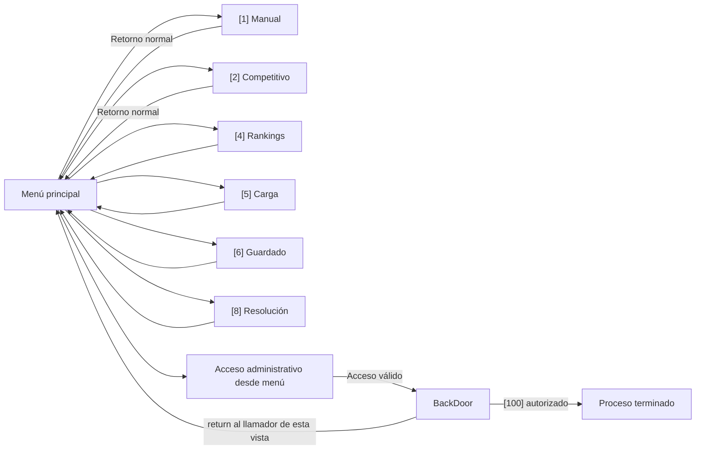

# Interfaz de consola y navegación — Sodoku C++ v0.9.4

Estado: Fase C aprobada.

- Base documental de trabajo: `docs/diagramas-sodoku`, commit **`79dd75bf9df0b7b4fce640ec0ec64482b82aec60`**.
- Evidencia **H**: informe histórico del **19/11/2026**, código **`d9cc5c6904db2f79930b9d5757a04766cd67502d`**; [H metadatos, L1–L8](../informes/INFORME_ARQUITECTURA_SODOKU.txt#L1-L8).
- Evidencia **I**: informe incremental del **24/11/2026**, código contrastado **`5c48cd4889ee3c94813ffea99269ae95ff6b80ee`**; [I §0, L7–L27](../informes/INFORME_ACTUALIZACION_ARQUITECTURA_5c48cd4.txt#L7-L27).
- Fuentes técnicas: los dos TXT históricos anteriores y, para la actualización local A+B de `[18]` sobre `main` `5f82994`, el [informe incremental del 26/11/2026, §1–2, L5–L36](../informes/INFORME_INCREMENTAL_BACKDOOR_18_AB_20261126.txt#L5-L36). Las referencias H conservan sus líneas históricas; I aporta la correspondencia actual de `varios.cpp`, con firmas y relaciones conservadas ([I §3–5, L108–L253](../informes/INFORME_ACTUALIZACION_ARQUITECTURA_5c48cd4.txt#L108-L253)). La revisión local C y la evidencia manual de Zorin se documentan en el [informe C, §1–3, L5–L45](../informes/INFORME_INCREMENTAL_BACKDOOR_18_C_REVISION_ZORIN_20261126.txt#L5-L45).

**COMPROBADO ESTÁTICAMENTE** identifica un camino o una asignación descritos por los informes. No acredita ejecución, comportamiento de una terminal ni exhaustividad de todas las combinaciones. **PENDIENTE** conserva los riesgos, la información no transcrita y los controles que necesitan verificación. Los nombres de vistas de este documento son identificadores documentales, no símbolos agregados al programa ([H §0, L39–L58](../informes/INFORME_ARQUITECTURA_SODOKU.txt#L39-L58)).

## 1. Alcance de las maquetas

Las cajas monoespaciadas son **maquetas documentales**, no capturas ni reproducción literal de `cout`. Solo los elementos y las reglas citados se presentan como comprobados estáticamente. Bordes, alineación, espacios, rótulos explicativos, `cij` y campos entre `<...>` son convenciones de esta maqueta. No se atribuyen esos caracteres al programa.

Los TXT no transcriben íntegramente cada menú, prompt, color, tecla de retorno ni pantalla. Esos detalles permanecen **PENDIENTES DE VERIFICACIÓN**. No se consulta el código para completarlos, no se ejecuta el juego y no se sustituye la evidencia por una interfaz supuesta ([H §0, L39–L58](../informes/INFORME_ARQUITECTURA_SODOKU.txt#L39-L58); [H §13, L1614–L1620](../informes/INFORME_ARQUITECTURA_SODOKU.txt#L1614-L1620)).

## 2. UI-01 — Menú principal, esquema de rutas conocidas

Evidencia: [H §7.1–7.3, L1057–L1083](../informes/INFORME_ARQUITECTURA_SODOKU.txt#L1057-L1083); [H §3, L281–L307](../informes/INFORME_ARQUITECTURA_SODOKU.txt#L281-L307); [H §10, L1357–L1359](../informes/INFORME_ARQUITECTURA_SODOKU.txt#L1357-L1359); [H §11, L1434–L1437](../informes/INFORME_ARQUITECTURA_SODOKU.txt#L1434-L1437). Los números mostrados están documentados; los rótulos describen la función sin afirmar el texto literal del menú.

```text
+----------------------------------------------------------+
| SODOKU C++ v0.9.4 — MAQUETA DOCUMENTAL                     |
| Créditos / marca de versión: <texto no transcrito aquí>   |
+----------------------------------------------------------+
| [1] Ingreso y edición manual                             |
| [2] Ingreso competitivo                                  |
| [3] Limpieza explícita del menú                           |
| [4] Consulta de rankings                                 |
| [5] Carga de una partida                                 |
| [6] Guardado de una partida                              |
| [7] Aviso de desarrollo                                  |
| [8] Resolución automática con guardia y confirmaciones    |
| [9] Aviso de desarrollo                                  |
| [10] Fijación pública de celdas                           |
+----------------------------------------------------------+
| Otras rutas existentes: configuración de Game Over,       |
| BackDoor y salida. Sus números/textos no se reconstruyen. |
+----------------------------------------------------------+
```

`autor()` presenta versión, créditos y tiempo calculado desde una fecha fija. El incremental registra cambios de créditos sin transcribir su contenido; la maqueta conserva ese límite. No se atribuye una fecha de compilación real a la marca de versión ([H §3, L479–L485](../informes/INFORME_ARQUITECTURA_SODOKU.txt#L479-L485); [H §1, L62–L70](../informes/INFORME_ARQUITECTURA_SODOKU.txt#L62-L70); [I §1, L29–L46](../informes/INFORME_ACTUALIZACION_ARQUITECTURA_5c48cd4.txt#L29-L46)).

Entrar a `[1]` conserva el contexto competitivo de los datos existentes. `[7]/[9]` no se muestran como funcionalidades terminadas. La fijación pública `[10]` y la herramienta administrativa `[20]` tienen alcances de acceso distintos; no se elimina esa diferencia al dibujar ([H §7.2, L1063–L1069](../informes/INFORME_ARQUITECTURA_SODOKU.txt#L1063-L1069); [H §10, L1357–L1361](../informes/INFORME_ARQUITECTURA_SODOKU.txt#L1357-L1361)).

## 3. UI-02 — Tablero 9 × 9, máscara y celdas fijas

Evidencia: [H §3, L154–L179](../informes/INFORME_ARQUITECTURA_SODOKU.txt#L154-L179); [H §3, L452–L472](../informes/INFORME_ARQUITECTURA_SODOKU.txt#L452-L472); [H §6, L973–L984](../informes/INFORME_ARQUITECTURA_SODOKU.txt#L973-L984); [H §6, L1043–L1050](../informes/INFORME_ARQUITECTURA_SODOKU.txt#L1043-L1050).

`cij` identifica simbólicamente una celda de la maqueta, no un valor guardado, un símbolo nuevo del programa ni un Sudoku de prueba. Se muestran nueve filas y nueve columnas, separadas en subcuadros; la disposición visual real queda sin certificar.

```text
MAQUETA: coordenadas lógicas, no impresión literal del programa
           1   2   3     4   5   6     7   8   9
        +-------------+-------------+-------------+
  1     | c11 c12 c13 | c14 c15 c16 | c17 c18 c19 |
  2     | c21 c22 c23 | c24 c25 c26 | c27 c28 c29 |
  3     | c31 c32 c33 | c34 c35 c36 | c37 c38 c39 |
        +-------------+-------------+-------------+
  4     | c41 c42 c43 | c44 c45 c46 | c47 c48 c49 |
  5     | c51 c52 c53 | c54 c55 c56 | c57 c58 c59 |
  6     | c61 c62 c63 | c64 c65 c66 | c67 c68 c69 |
        +-------------+-------------+-------------+
  7     | c71 c72 c73 | c74 c75 c76 | c77 c78 c79 |
  8     | c81 c82 c83 | c84 c85 c86 | c87 c88 c89 |
  9     | c91 c92 c93 | c94 c95 c96 | c97 c98 c99 |
        +-------------+-------------+-------------+
  MATRIZ: valores actuales        CELDAFIJA: protección
  MASCARA: fila / columna / intersección del ingreso
```

Comprobado: `DibujarPantalla()` representa tablero, fijas, máscara y números agotados. `limpiarMascara()` rellena con guiones y `marcarInterseccion()` usa `?`; no se inventan colores o glifos para representar un cero, una celda fija o una selección. El título de `mostrarMatriz()` es recibido por parámetro; los TXT no transcriben todos sus valores y no permiten garantizar aquí un literal para la carga terminada.

## 4. UI-03 — Ingreso y dificultad

Evidencia: [H §3, L196–L215](../informes/INFORME_ARQUITECTURA_SODOKU.txt#L196-L215); [H §7.5, L1097–L1110](../informes/INFORME_ARQUITECTURA_SODOKU.txt#L1097-L1110); [H §3, L328–L338](../informes/INFORME_ARQUITECTURA_SODOKU.txt#L328-L338). Los títulos de campos son explicativos.

```text
INGRESO — MAQUETA
  Fila:     <entrada>
  Columna:  <entrada>
  Valor:    <entrada o comando reconocido en este prompt>

DIFICULTAD — MAQUETA
  Elegir: <opción 1, 2 o 3>
  Cancelar selector: 0

GAME OVER — MAQUETA DE SU CONFIGURACIÓN
  endGame: <entero positivo>
  Cancelar configuración: 0
```

| Campo o situación | Regla comprobada | Límite de la maqueta |
| --- | --- | --- |
| Fila / columna | `0` retorna `ERROR_SALIR`; extracción o rango inválidos retornan `CANCELAR`. | No se trasladan los comandos especiales de valor a esos campos. |
| Valor | Reconoce `98`, `99` y `0`; el comando 99 no incrementa fallos por sí mismo. | El código no se presenta como credencial de acceso: la autenticación de BackDoor sigue siendo independiente. |
| Celda fija | El ingreso protege `CELDAFIJA`. | No se reconstruye un texto literal de rechazo ni cada detalle de su rama. |
| Celda ocupada | Puede cancelar o borrar; el borrado modifica el tablero y retorna `CANCELAR`. | Cancelar una operación no equivale siempre a conservar todos los datos. |
| Error lógico | Incrementa `intentosFallidos` en la rama correspondiente. | No se cuenta igual un error de formato, cancelación o salida. |
| Jugada aceptada | `OK` retorna fila/columna/valor por referencia; el llamador escribe. | En manual no se comprueba victoria; en competitivo sí se compara tras `OK`. |

La traducción de `IngresoStatus` a navegación está en [FLUJOS.md](FLUJOS.md). La enumeración pública tiene `OK`, `CANCELAR`, `BACKDOOR` y `ERROR_SALIR` ([H §6, L1037–L1041](../informes/INFORME_ARQUITECTURA_SODOKU.txt#L1037-L1041)). La dificultad interna 0..2, el encabezado persistido `Nivel:0/1/2/3` y el nivel administrativo 0/1/2 son conceptos distintos.

## 5. UI-04 — Confirmaciones de ingreso y resolución

Evidencia: [H §7.3, L1071–L1083](../informes/INFORME_ARQUITECTURA_SODOKU.txt#L1071-L1083); [H §7.9, L1152–L1164](../informes/INFORME_ARQUITECTURA_SODOKU.txt#L1152-L1164). Las frases siguientes son rótulos documentales, no citas literales del programa.

```text
[2] TABLERO COMPLETO — MAQUETA
  Completitud: sin ceros y coincidencia MATRIZ / SOLUCION
  Si no hay modoPruebasHabilitado: ingreso denegado
  Si hay permiso: confirmación S/N
  N / respuesta distinta de S/s: conservar estado de esa rama
  S/s: nivel existente o selección; ingreso por la ruta documentada

[8] RESOLUCIÓN AUTOMÁTICA — MAQUETA
  Primero: guardia de modo competitivo y permiso administrativo
  Camino permitido: consumir permiso de resolución
  Confirmación inicial: aceptar o cancelar
  Si se acepta: resolver copia y animar si se obtiene solución
  Confirmación final de sobreescritura: S/N
    N: restaurar MATRIZ original
    S: sincronizar SOLUCION y asignar las banderas documentadas
```

No se presenta una pregunta S/N de pruebas sin la condición de permiso correspondiente. El permiso de `[8]` ya está consumido al cancelar cualquiera de sus confirmaciones. Completar o cargar el tablero no equivale a una victoria inmediata: la ruta competitiva compara después de una jugada `OK`.

## 6. UI-05 — Selección de archivo y resultado de carga/guardado

Evidencia: [H §7.7–7.8, L1124–L1150](../informes/INFORME_ARQUITECTURA_SODOKU.txt#L1124-L1150); [H §8, L1201–L1228](../informes/INFORME_ARQUITECTURA_SODOKU.txt#L1201-L1228); [H §12.5, L1556–L1560](../informes/INFORME_ARQUITECTURA_SODOKU.txt#L1556-L1560).

```text
CARGA — MAQUETA
  Directorio: <directorio de trabajo del proceso>
  Archivos candidatos: <nombres con patrón YYYYMMDD-HHMMSS.txt>
  Orden: alfabético
  Selección/cancelación: <mecanismo del programa; literal no transcrito>

  Rechazo: <mensaje operativo>; globales previas de partida conservadas
  Aceptada parcial: datos aplicados, esperando ingreso desde menú
  Aceptada completa: mostrar tablero terminado y retornar

GUARDADO — MAQUETA
  Competitivo: requiere nivelCargado válido entre 0 y 2
  Archivo de salida: <nombre generado con fecha y hora locales>
  Datos: Nivel, MATRIZ, CELDAFIJA y bloque interno
  Resultado nominal: mensaje y pausa
```

Los nombres no se restringen a 2025 ni al año actual. El patrón no valida por sí mismo la fecha real ni si la entrada del directorio es un archivo regular. No se usan partidas originales en estas maquetas.

La carga puede mostrar información de estadísticas según la presencia del bloque interno, no simplemente según que los intentos sean positivos o la bandera de resolución sea `true`. No se inventa aquí un literal de banner. Una partida «antigua» solo es compatible si satisface la cabecera `Nivel` y las matrices requeridas. Los mensajes no certifican atomicidad ni éxito de todas las escrituras; ARQ-07/16 permanecen pendientes.

## 7. UI-06 — Rankings y final de una partida

Evidencia: [H §7.6, L1112–L1122](../informes/INFORME_ARQUITECTURA_SODOKU.txt#L1112-L1122); [H §7.10, L1166–L1177](../informes/INFORME_ARQUITECTURA_SODOKU.txt#L1166-L1177); [H §8.3, L1230–L1237](../informes/INFORME_ARQUITECTURA_SODOKU.txt#L1230-L1237); [H §11, L1447–L1453](../informes/INFORME_ARQUITECTURA_SODOKU.txt#L1447-L1453).

```text
RANKING — MAQUETA DE DATOS, SIN RESULTADOS REALES
  Dificultad interna: <0 / 1 / 2>
  Hasta cinco entradas por dificultad
  Campos ilustrados: <iniciales>  <fallos>  <duración de sesión>
  <entradas existentes o convención de vacíos del programa>

VICTORIA TRAS JUGADA — MAQUETA
  <estadísticas>
  Iniciales: <exactamente tres caracteres; conversión a mayúsculas>
  <carga, actualización, guardado y presentación del ranking>

GAME OVER — MAQUETA
  Condición: endGame > 0 e intentosFallidos >= endGame
  <resumen y acumulación de duración>
  <pausa y retorno; tablero y fallos se conservan>
```

Las columnas ilustradas proceden del modelo de datos, no de una transcripción completa de la tabla impresa. `ScoreEntry` contiene además nivel, errores permitidos y timestamp. `mostrarScores()` detiene la presentación al encontrar la convención `erroresFallidos==INT_MAX`.

La consulta del menú principal `[4]` muestra tres dificultades y no crea el archivo ausente; recarga memoria y pausa desde el menú. La victoria exige exactamente tres caracteres; no se afirma que exista un filtro alfanumérico completo por el texto del prompt. Las horas y el tiempo acumulado no se dan por verificados en Windows/Zorin.

## 8. UI-07 — BackDoor sin contenido de autenticación

Evidencia: [H §3, L443–L451](../informes/INFORME_ARQUITECTURA_SODOKU.txt#L443-L451); [H §7.11, L1179–L1187](../informes/INFORME_ARQUITECTURA_SODOKU.txt#L1179-L1187); [H §10, L1340–L1368](../informes/INFORME_ARQUITECTURA_SODOKU.txt#L1340-L1368). La caja no reproduce el menú de ningún nivel ni indica que todas las opciones se anuncien a todos los usuarios.

```text
ACCESO ADMINISTRATIVO — VISTA DOCUMENTAL
  <contenido de autenticación y pantallas sensibles omitidos>
  Resultado público: rol 0 / 1 / 2, o rechazo

HERRAMIENTAS PÚBLICAMENTE DESCRITAS — NO ES MENÚ LITERAL
  [15] Borrar ranking                 guardia: nivel >= 2
  [16] Exportar CSV                   sin guardia local documentada
  [17] Mostrar solución               guardia: nivel >= 1
  [18] Habilitar permisos de pruebas  guardia: nivel >= 1
  [20] Fijar todas las celdas          guardia: nivel >= 2
  [100] Terminar proceso              guardia: nivel >= 2
  [14] / [19]                         sin implementación
```

`[15]/[20]` pueden alcanzar sus `case` aun estando ocultas; las guardias operan antes del borrado/fijación. `[15]` autorizado confirma S/N y retorna al llamador; `[20]` usa `break` y redibuja el submenú. `[100]` autorizado termina el proceso.

La visibilidad de `[17]` y su guardia no coinciden plenamente. No se muestra ni se afirma un segundo factor efectivo. `[16]` conserva el comportamiento registrado sin aplicar una corrección de permisos por conveniencia de la maqueta. No se transcriben credenciales, nombres de variables de autenticación, claves, valores de acceso ni la pantalla que los expone.

Actualización local A+B de `[18]` sobre `main` `5f82994`: los siguientes textos literales proceden del [informe incremental, §3, L38–L56](../informes/INFORME_INCREMENTAL_BACKDOOR_18_AB_20261126.txt#L38-L56):

- Menú de niveles 1 y 2: `[ 18  ] Habilitar permisos administrativos para pruebas ([2] y [8]).`
- Primer mensaje: `Permiso habilitado para solicitar ingreso de pruebas en [2] cuando el tablero esté completo.`
- Segundo mensaje: `Permiso habilitado para un intento de [8] en contexto competitivo; se consume incluso si se cancela.`

Los mensajes anuncian permisos, sin dar por realizadas esas operaciones. En la revisión local C, `[18]` se anuncia en niveles 1 y 2 y permanece oculta y denegada en nivel 0; la guardia sigue siendo `nivelAcceso >= 1`. Los textos de A+B, las pausas y la vida de los permisos permanecen intactos ([informe C, §1, L5–L12](../informes/INFORME_INCREMENTAL_BACKDOOR_18_C_REVISION_ZORIN_20261126.txt#L5-L12)).

La incidencia **INC-5C48CD4-01** permanece separada: los TXT no permiten asignar su doble salida a un `case` concreto ni declararla reproducida o duplicada de ARQ-14 ([I §8, L298–L322](../informes/INFORME_ACTUALIZACION_ARQUITECTURA_5c48cd4.txt#L298-L322)).

## 9. UI-08 — Mensajes y pausas

Evidencia: [H §3, L348–L355](../informes/INFORME_ARQUITECTURA_SODOKU.txt#L348-L355); [H §7.12, L1189–L1197](../informes/INFORME_ARQUITECTURA_SODOKU.txt#L1189-L1197); [I §3, L121–L129](../informes/INFORME_ACTUALIZACION_ARQUITECTURA_5c48cd4.txt#L121-L129); [H §11, L1440–L1453](../informes/INFORME_ARQUITECTURA_SODOKU.txt#L1440-L1453).

```text
MENSAJE OPERATIVO — MAQUETA
  <texto de error, resultado o confirmación de la rama>
  <aviso de pausa cuando corresponde>
  <lectura de entrada pendiente y/o Enter según el contexto>
```

`mostrarError()` presenta color, restaura color y llama a `MSGPAUSA()`, incluso en algunos resultados exitosos. En `5c48cd4`, `MSGPAUSA()` está en `src/varios.cpp:106–111`; `ignore()` y `get()` dependen del contenido pendiente del stream. No se garantiza un único Enter para cualquier operación. Se conserva la retirada autorizada de las tres llamadas redundantes en `[15]/[20]`, sin uniformar los demás caminos.

En la revisión local A+B, `[18]` realiza una llamada a pausa por rama: los niveles 1/2 muestran los mensajes, restauran color y llaman a `MSGPAUSA()`; el nivel 0 conserva el error existente y la pausa interna de `mostrarError()`, sin una pausa adicional posterior. Los helpers no cambian. La cantidad de Enter depende de `cin`; la causa de dos avisos percibidos en una rama permitida sigue pendiente de correlación ([informe incremental A+B, §5, L82–L96](../informes/INFORME_INCREMENTAL_BACKDOOR_18_AB_20261126.txt#L82-L96)).

Pruebas manuales reportadas por el usuario en Zorin OS: nivel 0 denegado con una pausa; niveles 1 y 2 permitidos, con ambos mensajes correctos y una pausa. Se registran como aprobadas por el usuario para acceso, mensajes y pausas; no fueron ejecutadas por Codex. No se indicó SHA del binario probado ni comprobación del nuevo anuncio de C, por lo que esa visibilidad queda pendiente de prueba específica ([informe C, §2, L25–L33](../informes/INFORME_INCREMENTAL_BACKDOOR_18_C_REVISION_ZORIN_20261126.txt#L25-L33)).

## 10. UI-09 — Navegación desde el menú principal

### UI-NAV. Navegación funcional desde el menú, sin reset implícito

COMPROBADO ESTÁTICAMENTE; alcance: [H §7.1–7.11, L1057–L1187](../informes/INFORME_ARQUITECTURA_SODOKU.txt#L1057-L1187).



Es una proyección de rutas desde el menú, no un inventario de todas las salidas. BackDoor también se invoca desde los modos manual y competitivo y retorna a su llamador; esas rutas se describen en [FLUJOS.md](FLUJOS.md). Los efectos sobre banderas se separan en [ESTADOS.md](ESTADOS.md). Volver al menú no borra automáticamente tablero, modo o intentos.

## Registro de los 19 pendientes conservados

Todos los registros siguientes permanecen **PENDIENTES**. Que un aspecto esté comprobado estáticamente no cierra su observación ni demuestra su impacto en ejecución. Se conservan las 18 observaciones heredadas (13 P2 y 5 P3) y una incidencia independiente; no se crean issues ni se considera duplicada la incidencia nueva ([I §7–8, L279–L322](../informes/INFORME_ACTUALIZACION_ARQUITECTURA_5c48cd4.txt#L279-L322)).

| Registro | Prioridad heredada | Observación o incidencia | Evidencia |
| --- | --- | --- | --- |
| ARQ-01 · PENDIENTE | P2 | Reanudación con bandera no uniforme. | [H §11, L1372–L1376](../informes/INFORME_ARQUITECTURA_SODOKU.txt#L1372-L1376) |
| ARQ-02 · PENDIENTE | P2 | Cancelar dificultad no conserva todos los flags. | [H §11, L1377–L1382](../informes/INFORME_ARQUITECTURA_SODOKU.txt#L1377-L1382) |
| ARQ-03 · PENDIENTE | P2 | "Resuelto" no tiene un indicador único. | [H §11, L1383–L1386](../informes/INFORME_ARQUITECTURA_SODOKU.txt#L1383-L1386) |
| ARQ-04 · PENDIENTE | P2 | Variantes de limpieza conservan datos distintos. | [H §11, L1387–L1391](../informes/INFORME_ARQUITECTURA_SODOKU.txt#L1387-L1391) |
| ARQ-05 · PENDIENTE | P2 | Persistencia parcial del tiempo y estadísticas. | [H §11, L1392–L1396](../informes/INFORME_ARQUITECTURA_SODOKU.txt#L1392-L1396) |
| ARQ-06 · PENDIENTE | P2 | Punteros de localtime. | [H §11, L1397–L1401](../informes/INFORME_ARQUITECTURA_SODOKU.txt#L1397-L1401) |
| ARQ-07 · PENDIENTE | P2 | Formato y coherencia no uniformes. | [H §11, L1402–L1410](../informes/INFORME_ARQUITECTURA_SODOKU.txt#L1402-L1410) |
| ARQ-08 · PENDIENTE | P2 | Validadores y resolvedor no son sanitizadores. | [H §11, L1411–L1417](../informes/INFORME_ARQUITECTURA_SODOKU.txt#L1411-L1417) |
| ARQ-09 · PENDIENTE | P2 | Unicidad no garantizada. | [H §11, L1418–L1422](../informes/INFORME_ARQUITECTURA_SODOKU.txt#L1418-L1422) |
| ARQ-10 · PENDIENTE | P2 | Discrepancia de permiso de exportación. | [H §11, L1423–L1425](../informes/INFORME_ARQUITECTURA_SODOKU.txt#L1423-L1425) |
| ARQ-11 · PENDIENTE | P2 | Segundo factor anunciado sin verificación adicional. | [H §11, L1426–L1428](../informes/INFORME_ARQUITECTURA_SODOKU.txt#L1426-L1428) |
| ARQ-12 · PENDIENTE | P2 | Fijación pública y administrativa. | [H §11, L1429–L1433](../informes/INFORME_ARQUITECTURA_SODOKU.txt#L1429-L1433) |
| ARQ-13 · PENDIENTE | P3 | Opciones parciales y etiquetas. | [H §11, L1434–L1439](../informes/INFORME_ARQUITECTURA_SODOKU.txt#L1434-L1439) |
| ARQ-14 · PENDIENTE | P3 | Contratos de pausas aún mixtos. | [H §11, L1440–L1446](../informes/INFORME_ARQUITECTURA_SODOKU.txt#L1440-L1446) |
| ARQ-15 · PENDIENTE | P3 | Entrada y formato de iniciales. | [H §11, L1447–L1453](../informes/INFORME_ARQUITECTURA_SODOKU.txt#L1447-L1453) |
| ARQ-16 · PENDIENTE | P2 | Errores de persistencia. | [H §11, L1454–L1459](../informes/INFORME_ARQUITECTURA_SODOKU.txt#L1454-L1459) |
| ARQ-17 · PENDIENTE | P3 | Cabeceras y convenciones. | [H §11, L1460–L1465](../informes/INFORME_ARQUITECTURA_SODOKU.txt#L1460-L1465) |
| ARQ-18 · PENDIENTE | P3 | Documentación y metadatos desactualizados. | [H §11, L1466–L1477](../informes/INFORME_ARQUITECTURA_SODOKU.txt#L1466-L1477) |
| INC-5C48CD4-01 · PENDIENTE | Por determinar | Doble salida reportada al ingresar desde libre a BackDoor nivel 1 y elegir una opción oculta; causa y relación con ARQ-14 por verificar. | [I §8, L298–L322](../informes/INFORME_ACTUALIZACION_ARQUITECTURA_5c48cd4.txt#L298-L322) |

La incidencia nueva no tiene caso, causa o plataforma confirmados por el incremental. No se dibuja una doble salida como comportamiento verificado ni se asocia a `[15]` o `[20]` por inferencia.

## Revisión manual propuesta, no ejecutada

- Contrastar textos, orden de opciones, títulos, glifos, máscaras, colores y alineación con una ejecución autorizada en Zorin y Windows; conservar la distinción entre maqueta y captura.
- Registrar campo exacto, mensajes, recuperación de entrada y número de Enter en errores, confirmaciones y retornos, sin asumir que todos los helpers pausan igual.
- Revisar tablero completo, estadísticas, iniciales y ranking sin aceptar una victoria solo por el texto de la pantalla.
- Precisar la opción y secuencia de la incidencia nueva antes de relacionarla con ARQ-14.

Fuente: [H §13–14, L1614–L1652](../informes/INFORME_ARQUITECTURA_SODOKU.txt#L1614-L1652); [I §8, L298–L322](../informes/INFORME_ACTUALIZACION_ARQUITECTURA_5c48cd4.txt#L298-L322). Los detalles no transcritos por los informes permanecen pendientes; no se suplen con lectura del código.

## Verificación de esta entrega

Se comprobaron los enlaces, la correspondencia de los elementos públicos con los TXT y el diagrama de navegación. Las maquetas no contienen datos de partidas/rankings reales ni material de autenticación.

**Mermaid 11.12.1: sintaxis y renderizado SVG validados localmente en Chromium para el diagrama de este documento.**

No se compila ni se ejecuta el juego o un ejecutable de prueba. No se modifican los TXT, los documentos existentes, el código, las partidas ni los rankings. La Fase C fue revisada y aprobada; su publicación en `docs/diagramas-sodoku` está autorizada.
